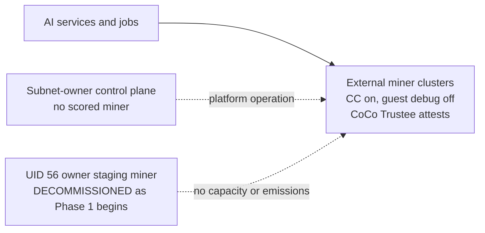
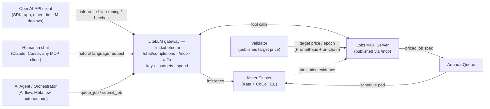

# KubeTEE AI Factory — Decentralized Clusters (Kube) for SOTA AI Services in Trusted Execution Environment (TEE)

> Enterprise-grade confidential computing for **SOTA AI services** and **enhanced services for enterprises** on decentralized Kubernetes across Bittensor miner clusters

---

## About

**KubeTEE AI** is the **AI Factory** of the Bittensor network: it turns decentralized GPU clusters into a confidential factory for **SOTA AI services** and **enhanced services for enterprises**. Inference, NVIDIA NeMo Platform services, retrieval, and agents run inside hardware-secured Trusted Execution Environments (TEE) using [Kata Containers](https://katacontainers.io/) and [Confidential Containers (CoCo)](https://github.com/confidential-containers/confidential-containers). **Batch jobs** (fine-tune, eval, multi-step pipelines) are one of those services — scheduled by [Armada](https://armadaproject.io/) when an agent needs

KubeTEE AI is registered with the [**NVIDIA Inception Program**](https://www.nvidia.com/startups/) and is an active contributor to both the [**Kata Containers**](https://katacontainers.io/) and [**Confidential Containers (CoCo)**](https://github.com/confidential-containers/confidential-containers) ecosystems. It also leverages [**CNCF**](https://www.cncf.io/) projects for cloud-native infrastructure.

### About the Owner

Known as Pierre in the Bittensor community, I have mined since February 2024. I was the first to bring Confidential Computing nodes to Targon (Subnet 4), later helped Chutes (Subnet 64) onboard B200/B300 nodes, and most recently worked with the Lium (Subnet 51) team to deploy Confidential Computing on their stack. Beyond Bittensor, I was also the first to provide Confidential Computing to Telegram Cocoon and Phala Network.

Forty years in infrastructure architecture and deployment at scale. I started in 1986 installing Linux and Novell servers, and in 1992 built one of the first internet providers in Canada. I deployed internet distribution infrastructure in Morocco and have managed tech stacks at scale for cloud providers. One of my specialty is security, and I have done multiple security audits for Fortune 500 companies.

### Motivation

My expertise in Confidential Computing, Kubernetes, networking, and security at the kernel and hardware level can benefit the Bittensor ecosystem. Having run infrastructure for the compute subnets for more than two years — monitoring, upgrades, and improvements to each subnet tech stack including recently onboarding B200/B300 on Chutes and H200 on Lium — I want to offer a different tech stack that I believe the ecosystem can benefit from and build on: the most secure and efficient decentralized AI Factory stack available.

**Direct Engineering Collaboration**: I work directly with **Intel** and **NVIDIA** engineers throughout the development and testing of NVIDIA technology, especially Kata and CoCo Containers. This close collaboration ensures optimal integration of confidential computing features, early access to emerging technologies, and validation of the KubeTEE implementation against the most stringent security and performance standards.

I actively contribute to OpenInfra and CNCF projects — [Kata Containers](https://katacontainers.io/) and [Confidential Containers (CoCo)](https://github.com/confidential-containers/confidential-containers) provide the TEE foundation for Kubernetes orchestration.

### Confidential Computing Consortium Resources

As a member of the [Confidential Computing Consortium (CCC)](https://confidentialcomputing.io/), I recommend two references:

- **[Protecting Agentic AI Workloads with Confidential Computing](https://confidentialcomputing.io/2026/01/20/protecting-agentic-ai-workloads-with-confidential-computing/)** (January 2026) — Mike Bursell, CCC Executive Director, on why an agent running in infrastructure its owner does not control needs hardware-rooted isolation and remote attestation to get identity integrity and capability confidentiality. That is precisely the threat model KubeTEE's Intel TDX/SGX + NVIDIA CC architecture addresses.
- **[Gartner Top 10 Strategic Technology Trends for 2026](https://www.gartner.com/en/articles/top-technology-trends-2026)** — Gartner ranks **Confidential Computing #3**, alongside AI Supercomputing Platforms (#2), Multiagent Systems (#4), Preemptive Cybersecurity (#7), Digital Provenance (#8), and AI Security Platforms (#9). KubeTEE spans all three of Gartner's themes: The Architect (AI infrastructure), The Synthesist (orchestration), and The Vanguard (security and trust).

### Mission & Vision

**Mission**: To turn decentralized multi-cluster GPU nodes into a worldwide (and in-space) confidential AI factory — hosting **SOTA AI services** and **enhanced services for enterprises** in Trusted Execution Environments across Bittensor miner clusters, with the highest standards of security, compliance, and performance.

**Key Differentiators**:
- **Security-First**: TEE-enabled infrastructure on a FIPS-validated RKE2 baseline with Kata Containers isolation
- **Multi Cluster Scheduler**: multi-cluster batch scheduling with fair-use queuing, gang scheduling, and preemption across decentralized clusters
- **SOTA AI services**: NVIDIA NeMo Platform, NIM models, and AI Blueprints as first-class confidential enterprise services — and, where NVIDIA's own stack falls short (see [Kata / CoCo Limitations](./docs/NEMO-MICROSERVICES-AND-SUBNET-INTEGRATIONS.md#4-kata--coco-limitations-nvidia)), SOTA [Bittensor subnet integrations](./docs/NEMO-MICROSERVICES-AND-SUBNET-INTEGRATIONS.md#5-the-bittensor-subnet-nemo-mapping) running inside Kata + CoCo TEE instead
- **Decentralized**: one hotkey per cluster, nodes located in distinct data center, expanding across global regions
- **Open Source**: Built on OpenInfra Foundation and CNCF projects with community-driven innovation

---

## Table of Contents

- [About](#about) — owner, motivation, mission
  - [About the Owner](#about-the-owner)
  - [Motivation](#motivation)
  - [Confidential Computing Consortium Resources](#confidential-computing-consortium-resources)
  - [Mission & Vision](#mission--vision)
- [Overview](#overview)
  - [Phase 1: Expansion and external miners](#phase-1-expansion-and-external-miners)
  - [What Ships Today](#what-ships-today)
- [The Confidential Compute Challenge: Problems We Solve](#the-confidential-compute-challenge-problems-we-solve)
- [Deploying in a TEE: The Engineering Challenge](#deploying-in-a-tee-the-engineering-challenge)
- [Phase 0 staging & Phase 1 transition](#phase-1-transition)
- [Architecture](#architecture)
  - [Confidential Computing (Kata + CoCo)](#confidential-computing-kata--coco)
  - [Infrastructure](#infrastructure) — RKE2 HA; Armada for the batch-job service
  - [Security & Compliance](#security--compliance)
  - [Multi-Cluster Topology](#multi-cluster-topology)
  - Phase 0 topology history is recorded inline with the multi-cluster diagram
- [Supported SOTA AI Services](#supported-sota-ai-services)
  - [Serving Configurations](#serving-configurations--every-service-requires-fast-inference)
  - [NVIDIA NeMo Platform & Bittensor Subnet Integrations](#nvidia-nemo-platform--bittensor-subnet-integrations) — attestation-gated TLS, NIM Operator Kata/CoCo limits, SOTA Bittensor subnet substitutes, Stage 0 supply-chain CI
- [Subnet Economics](#subnet-economics)
  - [Incentive Mechanism: Infrastructure](#incentive-mechanism-infrastructure)
  - [Payment methods](#payment-methods)
  - [Staging vs Production](#staging-vs-production)
- [Tokenomics — Utility Token & DePIN Model](#tokenomics--utility-token--depin-model)
- [Validator Scoring & Attestation](#validator-scoring--attestation)
  - [Validator Runtime (TEE)](#validator-runtime-tee)
  - [Evidence Feeds](#evidence-feeds)
  - [Competitive Pricing](#competitive-pricing)
  - [Weight Setting](#weight-setting)
- [Submitting a Confidential Job](#submitting-a-confidential-job)
  - [LiteLLM Gateway — the multi-service front door](#litellm-gateway--the-multi-service-front-door)
  - [Inference providers and TEE fallbacks](#inference-providers-and-tee-fallbacks)
  - [SN28 sayGM — idle capacity, not the product](#sn28-saygm--idle-capacity-not-the-product)
  - [Workflow Orchestration (Airflow & Metaflow)](#workflow-orchestration-airflow--metaflow)
  - [Jobs MCP Server](#jobs-mcp-server) — agent and chat-driven job deployment
- [For Miners (Infrastructure)](#for-miners-infrastructure)
  - [Miner onboarding](#miner-onboarding)
  - [Miner deposit (registration collateral)](#miner-deposit-registration-collateral)
- [Roadmap](#roadmap) — [Phase 0](#phase-0--early-access-completed) · [Phase 1](#phase-1--expansion) · [Phase 2](#phase-2--paid-jobsservicesinference) · [Phase 3](#phase-3--job-typeservices-growth)
- [Research & Documentation](#research--documentation)
- [Community & Support](#community--support)

---

## Overview

KubeTEE AI Factory provides enterprise-grade confidential computing for **SOTA AI services** on a decentralized multi-cluster Kubernetes RKE2 infrastructure. Services run inside Trusted Execution Environments (TEE) so that data and models are protected **at rest, in transit, and in use** — and never leave the confidential computing boundary. **Batch jobs** (fine-tune, eval, pipelines) are a secondary service on the same clusters, submitted to Armada queues when needed.

Each miner cluster is identified by a permanent Bittensor **hotkey/coldkey** pair. **SOTA AI services** run as Kubernetes pods under a confidential `runtimeClassName` so they are hardware-isolated and attested. When that service is a batch job, Armada dispatches it. TEE classes are **`kata-qemu-nvidia-gpu-tdx-runtime-rs`** (GPU) and **`kata-qemu-tdx-runtime-rs`** (CPU-only). Miner clusters keep CC on and guest debug **off**; CoCo Trustee attests those guests. **From Phase 1, only external miners are onboarded and scored:** the subnet-owner staging miner **UID 56** (`na-us-oakland-56`) was decommissioned as a miner at that transition and is not a capacity or emissions source. Subnet-owner infrastructure runs the control plane, not a scored miner.

The RKE2 baseline is **[FIPS-140-2 validated](https://docs.rke2.io/security/fips_support)** today; FIPS-140-3 is a [Phase 3](#phase-3--job-typeservices-growth) target. Both are referred to below simply as the FIPS-validated baseline.

> **Open-source by default.** Every technology in the KubeTEE stack is open source — RKE2, Rancher, Kata Containers, Confidential Containers, Armada, LiteLLM, Longhorn, cert-manager, NVIDIA GPU Operator, and the Bittensor subtensor SDK. KubeTEE does not vendor-lock or proprietary-fork any of them. Where KubeTEE adds patches, fixes, or features (e.g. the Kata runtime-rs NVSwitch passthrough fix, the CSI direct-volume data-loss fix, the LiteLLM provider integration), the modifications live in **forks under the [KubeTEE-AI](https://github.com/KubeTEE-AI) GitHub organization** and are contributed upstream wherever the upstream project accepts them. The forks are public so anyone can audit what changed, and the contribution path back to upstream is the long-term goal for every patch.

### Phase 1: Expansion and external miners

**Early Access (Phase 0) is complete. KubeTEE is now in Phase 1.** The subnet is expanding as a multi-cluster network of **external miners**: each participant operates its own RKE2 cluster, with CC on and Kata guest debug off, and is evaluated by the validator. The subnet owner operates the control plane, validator, and platform services—not a scored miner. **UID 56 (`na-us-oakland-56`), the former owner-operated staging miner, is decommissioned** and receives no miner capacity score or emissions. See [Phase 0 staging and the Phase 1 transition](#phase-1-transition).

Phase 0 established the confidential Kata + CoCo runtime, the initial validator incentive mechanism, the Armada multi-cluster scheduling design, and the external-miner onboarding path. Phase 1 uses that foundation without naming individual miners or specific miner clusters in this public overview.

Phase 1 adds demand-driven **Blackwell-only** expansion (3+ nodes of the same GPU type per cluster), transitioning away from Hopper (H100/H200). **Permissionless self-service registration, paid Alpha/TAO services, and deposit enforcement remain Phase 1 work in progress** (see [Roadmap](#phase-1--expansion)); they are not implied to be live by entering the phase. See [Miner onboarding](#miner-onboarding) and [Subnet Economics](#subnet-economics).

### What Ships Today

This README documents both what runs in the KubeTEE infrastructure and what is designed. Sections describing unimplemented work carry a status note pointing back here; this table is the single source of truth for the distinction. **The Bittensor validator v1 is built, tested, and live on Finney** — it scores miners on a single Infrastructure mechanism and sets weights once per epoch. The "Designed / to be built" column lists future-scoring dimensions on top of that base.

| Area | Exists today (infrastructure / design) | Designed / to be built |
|------|--------------------|--------------------|
| **Miner&nbsp;fleet** | **Phase 1:** only external miners are eligible for onboarding and scoring. Each qualifying miner operates its own RKE2 cluster with CC on and guest debug off. Owner staging UID 56 is decommissioned and receives no miner capacity score or emissions | Demand-driven Blackwell expansion. Permissionless external registration remains Phase 1 work, not a deployed feature ([Roadmap](#phase-1--expansion)) |
| **Confidential&nbsp;runtime** | Kata **4.3.1** + CoCo TEE runtime-rs classes (`kata-qemu-nvidia-gpu-tdx-runtime-rs` / `kata-qemu-tdx-runtime-rs`), with CC on and guest debug off. Phase 0 also validated these classes on Kata 4.2.0 | AMD SEV-SNP multi-arch + NVIDIA RTX PRO 6000 Blackwell Server Edition testing ([Phase 1](#phase-1--expansion)) |
| **Service&nbsp;transport** | The validated Phase 0 pattern: grey-cloud DNS + Traefik TLS passthrough into the LiteLLM TDX guest, with attestation-gated TLS to model backends. The former Oakland gateway is not the Phase 1 control-plane deployment | Migrate this gateway pattern off Oakland; validate the new endpoint and backend chain before claiming client-facing service. Native TLS from the LiteLLM guest to external-miner NIM guests |
| **Owner&nbsp;staging&nbsp;miner** | **Decommissioned as Phase 1 begins** — UID 56 (`na-us-oakland-56`) is not a scored miner or source of miner emissions. Owner control-plane infrastructure is separate from miner eligibility | — |
| **Security&nbsp;gate** | Supply-chain CI is a **design reference** (manual/advisory practice) — automation removed from the roadmap (2026-10-19) | — |
| **Validator&nbsp;scoring** | **v1 live on Finney:** binary infrastructure-readiness gate (hotkey binding, Rancher readiness, HA topology, capacity, 8-GPU passthrough, confidential runtime handler) + USD-denominated compensation pricing via Taostats + Targon SN4 supply-side clamp + [KubeTEE Validator/Miners Dashboard](https://s3.hippius.com/kubetee-validator/index.html) (hosted on Hippius) | `PROBATION`→`EARNING` state machine; fresh TEE attestation, Armada job metrics, serving probes, workload identity |
| **Validator&nbsp;pricing** | **v1.3 live:** Taostats compensation feed (`api/dtao/pool/latest/v1`) + Targon SN4 payout feed (snapshot API `statistics.getSnapshot` — highest live $/card per class, MAX-payout fallback for classes with no supply) + per-GPU price card (H100 $4 / H200 $5.50 / B200 $8 / B300 $10 / RTX6000 $2.50 /GPU/hr) with manual per-class floors on the published card; one `set_weights` per epoch with rate-limit cooldown | Lium / Chutes demand-side scrape, per-job-class target price, price-competitiveness weighting |
| **Validator&nbsp;runtime** | **v1 live:** flat self-contained Python unit (14 modules, 96 tests) running as a container on the operator's machine; sets weights once per epoch | Run inside a Kata + CoCo TEE pod on the control plane with CoCo remote attestation (the referee itself attested) ([Phase 2](#phase-2--paid-jobsservicesinference)) |
| **Armada** | **Not deployed** — Phase 0 scoped the Server on the owner control plane and the Executor on each miner cluster | Finish the Phase 1 carry-over deployment; move into Kata + CoCo TEE pods with attestation-gated TLS in [Phase 2](#phase-2--paid-jobsservicesinference) |
| **Miner&nbsp;onboarding** | KubeTEE onboards **external miners** and applies the hotkey binding; no owner-operated miner is eligible | Permissionless self-service external-miner registration is Phase 1 work in progress ([Roadmap](#phase-1--expansion)) |
| **Miner&nbsp;deposit** | **Not collected during Phase 0 Early Access** | 10 TAO/node deposit measurement → enforcement, plus on-chain collateral bonding: Phase 1 work in progress ([Roadmap](#phase-1--expansion)) |
| **Payments** | **TAO is live on Base** (Chainlink CCIP-bridged ERC-20, Aerodrome TAO/USDC — [ForeverMoney](https://x.com/forevermoney_ai/status/2090469070248235027), 2026-08-21) — the payment rail exists | Alpha / TAO paid jobs (demand-side) at the resources price per hour; USDC-on-BASE and TAO-on-BASE job billing + automated recycle ([Phase 1](#phase-1--expansion)) |
| **LiteLLM&nbsp;gateway** | `llm.kubetee.ai` — OpenAI-compatible inference, virtual keys, budgets, rate limits, and spend tracking. Its Oakland deployment and the sayGM-connected model routes are **Phase 0 history**; a former staging-miner address must not be carried into Phase 1. Only external-miner clusters supply confidential `api_base` backends. The owner control plane will operate the migrated gateway and is not a miner | Complete the control-plane gateway migration off Oakland and validate the retained external-miner backend. Wire `/mcp` and `/a2a` and fine-tuning / batch through to Armada; upstream LiteLLM **provider** integration; RA-TLS; [TEE fallbacks](#inference-providers-and-tee-fallbacks) |
| **Inference&nbsp;models** | Confidential model backends run on qualifying external-miner clusters behind the migrated `llm.kubetee.ai` control plane. Historical deployments and paid offers are not the Phase 1 catalogue; availability requires a current backend and gateway validation. Nemotron-3-Nano-Omni remains **evaluation-only** subject to licensing, not a billed SKU. SN28 sayGM was connected as an inference provider and idle-capacity demand channel in Phase 0 | New external-miner backends and expanded confidential model catalogue. TEE router fallbacks (Chutes / Phala / Near AI) are [Phase 2](#phase-2--paid-jobsservicesinference) work. Past model availability must not be represented as live without a current deployment |
| **Jobs&nbsp;MCP&nbsp;server** | — | **Not developed yet** — agent- and chat-driven job deployment at `llm.kubetee.ai/mcp` ([Phase 3](#phase-3--job-typeservices-growth)) |

---

## The Confidential Compute Challenge: Problems We Solve

Enterprises running sensitive SOTA AI services — inference, agents, training, fine-tuning, data processing — face an impossible choice between security, cost, and trust. KubeTEE resolves all three:

1. **Private data & models must stay private** — Public cloud AI and traditional deployments expose data in memory and give providers/insiders access. KubeTEE enforces hardware TEE isolation (Intel TDX/SGX, NVIDIA CC) via Kata + CoCo, with remote attestation so you can verify the exact code running on your data; data is protected at rest, in transit, and in use.
2. **Regulated AI services need verifiable compute** — Healthcare (HIPAA), Finance (SOC2/PCI-DSS), Government (FedRAMP) need proof of isolation. KubeTEE provides a FIPS-validated RKE2 baseline, cryptographic attestation, audit trails (Prometheus, Kubernetes events), and isolated namespaces for tenant separation.
3. **Trust in decentralized infrastructure** — Centralized clouds are single points of failure with vendor lock-in. KubeTEE's decentralized multi-cluster architecture, Bittensor incentives, validator attestation, and open standards (Kubernetes, Armada, Kata, CoCo) remove the single point of failure and the lock-in.

---

## Deploying in a TEE: The Engineering Challenge

**A confidential pod is a virtual machine with an encrypted, attested memory boundary, not a namespaced process on the host.** Every assumption a Kubernetes workload makes about devices, storage, resources, startup time, and debuggability is renegotiated at that boundary — multi-GPU/NVSwitch passthrough, guest-vs-pod sizing, cold start, storage semantics, observability, destructive failures, and version-coupled stacks. Each has been hit bringing up this stack, and most have an upstream issue attached.

### Example: Upstream Participation — kata-containers #13535

KubeTEE does not just consume upstream projects; it hardens them and reports what it finds. A concrete example from Phase 0 Early Access:

While bringing up a 2.5 TB Kimi-K3 inference pod (8× B300 GPU passthrough) under `kata-qemu-nvidia-gpu-tdx-runtime-rs`, the sandbox hung at boot and hit the 1200s `create_container` timeout before the guest kernel even started. Root cause: the `OVMF.inteltdx.fd` shipped in **kata-deploy v4.0.0** performs **eager memory acceptance** for Intel TDX guests — spending all its time in `TDCALL [TDG.MEM.PAGE.ACCEPT]` for large-memory VMs. The distro `ovmf-inteltdx` (Ubuntu, with lazy-accept enabled by `PcdLazyAcceptPartialMemorySize=512`) booted the same 512 GB TDX VM in under 15 seconds. KubeTEE filed the issue with full evidence (serial logs, kata config, kernel `CONFIG_UNACCEPTED_MEMORY=y`), root-cause analysis (Config-A vs Config-B build, PCD defaults), and three proposed solutions — [kata-containers#13535](https://github.com/kata-containers/kata-containers/issues/13535).

KubeTEE's Kata base is **4.3.1**, validated during Phase 0 and deployed on external-miner clusters. Stock 4.3.1 ships lazy-accept `edk2-stable202608` via [#13717](https://github.com/kata-containers/kata-containers/pull/13717), so the OVMF overlay is retired; [#13535](https://github.com/kata-containers/kata-containers/issues/13535) closed completed 2026-10-27. The **`v4.3.1-fix11649-t15t16`** shim overlay remains for [#11649](https://github.com/kata-containers/kata-containers/issues/11649) (deterministic duplicate block-device ID after init-container unplug) and the T15/T16 missing-task teardown path ([#13665](https://github.com/kata-containers/kata-containers/issues/13665)/[#13746](https://github.com/kata-containers/kata-containers/issues/13746)); host shim `96bcd8efa4cb…`, stock lazy-accept OVMF `2a2dc271…`. Retired 4.2.0 overlay details are historical, not current recovery instructions. See [TEE deployment](./docs/TEE-DEPLOYMENT-AND-CICD.md#runtime-classes-kata-431).

This is the Phase 0 model that established KubeTEE's upstream engineering practice: isolate failures using the staging-debug environment and the distro OVMF comparison, file reproducible root causes and fix proposals, and carry a local workaround until the upstream fix lands. The owner-operated staging miner is decommissioned from Phase 1; the external-miner-only boundary does not require a replacement staging miner. KubeTEE maintains a fork branch with pre-built lazy-accept OVMF from `edk2-stable202608` (202605 + the TDVF below-4G fix) and a reproducible build workflow for pipeline testing.

---

## Phase 1 transition

**As Phase 1 begins, the subnet-owner staging miner role is decommissioned. UID 56 is withdrawn from miner capacity, scoring, and emissions. From now on, only external miners are onboarded.** The owner-operated control plane, validator, and platform services are infrastructure, funded by the owner's emission share—not miner scoring or capacity payments.

Supply-chain CI (SAST, Trustee secrets, image CVE, IaC) is a design reference — automating it is no longer a roadmap deliverable — see [the security gate](./docs/NEMO-MICROSERVICES-AND-SUBNET-INTEGRATIONS.md#6-stage-0--supply-chain-security-gate). Detail: [Deploying in a TEE](./docs/TEE-DEPLOYMENT-AND-CICD.md).

---

## Architecture

### Confidential Computing (Kata + CoCo)

**Trusted Execution Environment (TEE)**
- Kata Containers for workload isolation
- Confidential Containers with Workload Identity Validation
- Intel TDX (6th Gen Xeon Granite Rapids) with TDX/SGX; AMD SEV-SNP (6th Gen EPYC 9006) from [Phase 1](#phase-1--expansion)
- NVIDIA Blackwell / Vera Rubin — Hopper (H100/H200) is deprecated (existing nodes only; removed as new Blackwell nodes are onboarded, target November 2026)

Confidential services execute under the TEE runtime classes in the [Overview](#overview) on external miner clusters. Kata guest debug is off and CoCo Trustee attests those guests. Batch jobs use the same runtime classes; see [Armada Multi-Cluster Batch Scheduling](#armada-multi-cluster-batch-scheduling) for that secondary path.

### Infrastructure

#### Kubernetes High Availability

**RKE2 Rancher Kubernetes**
- FIPS-validated, U.S. Federal Government Grade Security
- Fully conformant distribution focused on security and compliance

**Multi-Cluster Management**
- [Rancher Fleet](https://fleet.rancher.io/) GitOps-based Multi-Cluster Management
- Regional deployment: Americas, EU, Middle East, Africa, Asia
- Native integration with Rancher for unified management

**Rancher UI RBAC Management**
- Users/Miners access to isolated Kubernetes Namespaces
- Project-based resource isolation
- Fleet workspaces for multi-tenancy

#### Armada Multi-Cluster Batch Scheduling

[Armada](https://armadaproject.io/) ([GitHub](https://github.com/armadaproject/armada)) is a CNCF Sandbox multi-cluster Kubernetes batch scheduler. It transforms Kubernetes into a high-throughput batch platform while remaining compatible with service workloads, and is used in production to run millions of jobs per day across tens of thousands of nodes.

**Component placement**:
- **Armada Server** (controller, scheduler, lookout + Pulsar/Redis/Postgres) runs on the **subnet-owner control plane** alongside the validator
- **Armada Executor + Installer** run on **each miner cluster**, turning the cluster into a scheduling target (pool)
- Jobs are submitted to **Armada queues** and scheduled across miner clusters with **fair-use queuing**, **gang scheduling**, and **preemption**

**Confidentiality of the scheduler itself** is a second step, not part of the initial install. Phase 0 scoped Armada, but that deployment carries into Phase 1 because it was not completed; [Phase 2](#phase-2--paid-jobsservicesinference) moves the Server and Executors into Kata + CoCo TEE pods and puts [attestation-gated TLS](./docs/NEMO-MICROSERVICES-AND-SUBNET-INTEGRATIONS.md#2-attestation-gated-tls-between-services) on the Server-to-Executor control channel, so a scheduler will not dispatch to an executor that cannot attest and an executor will not accept work from an unattested scheduler. Until then the scheduler is trusted infrastructure while the *jobs* it dispatches are already confidential.

**Confidential execution**:
- Jobs land on external miner nodes with a confidential `runtimeClassName` — `kata-qemu-nvidia-gpu-tdx-runtime-rs` for Intel TDX + NVIDIA GPU passthrough, `kata-qemu-tdx-runtime-rs` for CPU-only TDX.
- **CoCo + Trustee/KBS** handle remote attestation when guest debug is off, so the job image needs no modification to run confidentially.

Armada addresses Kubernetes batch limitations that matter for the Factory: single-cluster scaling limits, etcd throughput ceilings, and the lack of fair-use / gang scheduling in the default kube-scheduler.

> **Status:** Armada is not deployed yet. Its Phase 0 scope carries into Phase 1; moving Server and Executors into TEE remains [Phase 2](#phase-2--paid-jobsservicesinference) work ([What Ships Today](#what-ships-today)).

### Security & Compliance

#### Network Security
- Network Policies enforcement (Calico)
- RBAC (Role-Based Access Control)

#### Data Protection
- **Rancher Longhorn**: Encrypted Storage with 3 Replicas
- Encrypted Container Repository
- **CoCo Trustee / KBS** — secrets and image-decryption keys are released only to an attested guest (guest debug off). Not Kubernetes Secrets, not Git.

#### Monitoring & Audit
- Prometheus Metrics
- Kubernetes Events tracking
- UpTime, QoS, and Performance monitoring
- Loki + Grafana Alloy log aggregation

### Multi-Cluster Topology

#### Subnet Owner Infrastructure

The owner operates the control plane, not a scored miner. From Phase 1, one external organization owns each miner cluster; no owner-operated staging miner is included in this production footprint.
- Global Multi-Cluster Control Plane with Rancher on Confidential Computing TEE
- Rancher Multi-Cluster Management with Fleet for GitOps
  - RKE2 Rancher Kubernetes (FIPS-validated baseline)
  - Kata Containers (TEE)
  - [Confidential Containers](https://confidentialcontainers.org/docs/overview/) Operator
  - Armada Server (controller, scheduler, lookout + Pulsar/Redis/Postgres)
- Validator on the control plane; running it in a TEE is a [Phase 2](#phase-2--paid-jobsservicesinference) item (see [Validator Runtime (TEE)](#validator-runtime-tee))

#### Miner Infrastructure
- RKE2 Rancher Kubernetes
- One Cluster per External Miner (identified by hotkey, not UID)
  - One data center per cluster — all nodes co-located in a single DC
  - Regional deployment (One Region/Zone Control Plane with same region workers)
  - Cluster carries the `kubetee.ai/hotkey` binding label, **applied by the
    KubeTEE platform** during enrollment — not something the miner creates
- Kata Containers and CoCo Containers (TEE)
- Armada Executor + Installer (scheduled by the subnet-owner Armada Server)
- Fleet Agent for automated deployments

> The **Validator** runs on the subnet-owner control plane; moving it into a confidential Kata + CoCo TEE pod is a [Phase 2](#phase-2--paid-jobsservicesinference) item (see [Validator Runtime (TEE)](#validator-runtime-tee)). The **Armada Server** and **Executors** are drawn here as designed. Their Phase 0 deployment milestone was not completed; they remain carry-over work before moving into TEE pods in [Phase 2](#phase-2--paid-jobsservicesinference) ([What Ships Today](#what-ships-today)).
>
> **Phase 1 topology.** Every qualifying miner cluster belongs to an external miner, keeps CC on with guest debug off, and is identified by its registered hotkey. The owner staging miner UID 56 (`na-us-oakland-56`) is **decommissioned as Phase 1 begins** and is not carried forward as a miner or emissions recipient; owner infrastructure operates the control plane only. This public overview does not enumerate participants or miner locations. See [For Miners (Infrastructure)](#for-miners-infrastructure) and [Phase 1 transition](#phase-1-transition).

---

## Supported SOTA AI Services

KubeTEE AI Factory hosts **SOTA AI services** and **enhanced services for enterprises** inside Kata + CoCo TEE pods — inference (NIM / SGLang), retrieval, and agents — shared HA per cluster. NVIDIA NeMo Platform templates are a planned addition to the NVIDIA AI stack alongside NIM models and AI Blueprints; their confidential-runtime compatibility has not been validated.

**Batch jobs** (fine-tune, eval, multi-step pipelines) are a secondary service on the same clusters. When an agent needs that path, the job is submitted to an Armada queue.

### Serving Configurations — Every Service Requires Fast Inference

Confidential execution is not an excuse for slow inference. **Every AI service on KubeTEE requires fast inference**, whether it is an agent loop, a consumer chat session, or an overnight batch. The Kata + CoCo boundary is a security property, not a performance tax, and each service is held to a latency and throughput target inside the TEE.

No single operating point serves an agentic tool-calling loop and a heavy-context batch equally well, so **every model is published in three serving configurations**. All three run the same attested weights on the same confidential runtime — what differs is how the serve is tuned: concurrency ceiling, batching and chunked-prefill sizing, KV-cache budget, and speculative decoding.

| Configuration | Target service | Optimized for |
|---------------|-----------------|---------------|
| **Low-latency** | Agentic, low concurrency | Time-to-first-token and per-token latency for tool-calling loops, where every hop blocks the caller. Concurrency is deliberately capped to keep the tail predictable. |
| **Balanced** | General, consumer-aligned | The default consumer-facing operating point — interactive chat responsiveness at a sane occupancy per GPU. |
| **High-throughput** | Batches and heavy-context jobs, no human in the loop | Aggregate tokens per second per GPU — long-context ingestion, evaluation sweeps, and bulk generation, where queueing is acceptable and hardware efficiency dominates. |

A consumer picks the configuration alongside the model at submission. Because the choice determines how much hardware the job occupies and for how long, it is the main lever a consumer has over the resources price per hour (see [Subnet Economics](#subnet-economics) and [Jobs MCP Server](#jobs-mcp-server)).

### NVIDIA NeMo Platform & Bittensor Subnet Integrations

[NVIDIA NeMo Platform](https://docs.nvidia.com/nemo-platform/documentation/kubernetes-deployment/setup) (Customizer, Evaluator, Guardrails, and Retriever) is the **planned** shared platform that other SOTA AI services — and, secondarily, batch jobs — would call inside the confidential boundary, with shared HA per cluster. It supersedes the standalone NeMo Microservices suite; NIM inference remains a separate model-serving layer. NeMo Platform deployment and Kata + CoCo compatibility have **not been validated** and must not be assumed from the existing inference services. Any deployed confidential service-to-service traffic uses **attestation-gated TLS** — in-guest keypairs, certificates issued only against a valid attestation, and TLS termination inside the guest — not cert-manager, not a service mesh, not host-level encryption, because the host is the adversary. The NVIDIA NIM Operator deploys NIM inference workloads (the deprecated legacy NeMo-service CRDs are not the NeMo Platform installation path), and has **experimental** Kata sandbox + Dynamo support for **NIM inference**, but KubeTEE uses the **stable** `kata-qemu-nvidia-gpu-tdx-runtime-rs` / `kata-qemu-tdx-runtime-rs` classes and is working with NVIDIA to graduate the experimental paths (Phase 3).

Given the NIM Operator's current Kata/CoCo limitations, KubeTEE's thesis is that **the Bittensor ecosystem already contains SOTA, verifiable substitutes** for several NeMo stack layers. Each subnet below exposes a verifiable feed (public API + on-chain metagraph) and is a **potential partnership** — a candidate integration, not a shipping integration — that could run inside `kata-qemu-nvidia-gpu-tdx-runtime-rs` / `kata-qemu-tdx-runtime-rs` with its outputs attested and persisted on confidential storage. This is the Bittensor-native path to a confidential AI Factory not locked to a single vendor's experimental stack.

| NeMo layer | Bittensor subnet (potential partner) | What it could replace/augment |
|---|---|---|
| Customizer (fine-tuning) | [Gradients SN56](https://www.gradients.io/) | AutoML tournaments — open-source SFT/DPO/GRPO training scripts |
| Customizer (RL/reasoning) | [Affine SN120](https://www.affine.io/) | Incentivized RL "reason mining" — challenger-vs-champion duels |
| Search | [Desearch SN22](https://desearch.ai/) | Decentralized real-time web + X/Twitter search for AI agents |
| Retriever / RAG | *on hold* — SN31 rec4ll marked inactive (no public repo, repeated missed launches; revisit on serious news) | The decentralized-RAG fit (embed → retrieve → generate in the TEE) remains the target mechanism |
| Video Search & Summarization | [Score SN44](https://github.com/score-technologies/turbovision) | Decentralized computer vision — object detection, tracking, structured annotations |
| Inference + distributed training | [Chutes SN64](https://chutes.ai/) / Parallax | Serverless inference + decentralized MoE training (already fully TEE-only). Also a [LiteLLM TEE fallback](#inference-providers-and-tee-fallbacks) (Phase 2) |
| Inference (LiteLLM provider) | [sayGM SN28](https://saygm.com/) | Connected to `llm.kubetee.ai` as an inference provider — models on the gateway; idle-capacity inbound from sayGM buyers. Fallbacks are other TEE networks, not a loop back through sayGM |
| Smart model routing | [NVIDIA NeMo Switchyard](https://github.com/NVIDIA-NeMo/Switchyard); [REAX SN92](https://reax.co/) and [Fugal SN70](https://www.fugalai.com/) — routing contenders | Optional routing between efficient and capable models, evaluated on completed-task cost and quality without changing the customer's confidential-computing expectations |
| Agent skills (evaluated partnerships) | [TrajectoryRL SN11](https://trajrl.com/) — **candidate skills source**; [sundae_bar SN121](https://www.sundaebar.ai/) — **business-workflow source** | Selected competition-produced skills, adapted for KubeTEE services and considered for the planned Agent Skills Hub. SN11 currently burns miner emissions; SN121's competitions pause between challenges. Availability depends on a current artifact and supply agreement |
| Persistent storage | [Hippius SN75](https://hippius.com/) | S3-compatible + IPFS pinning (already ships AMD SEV-SNP CC) |

This is an **open set**: any Bittensor subnet with a SOTA, verifiable solution for a NeMo stack layer is a candidate. The full table with SOTA roles, confidential-computing fit, and the "could replace/augment" mapping: [NVIDIA NeMo Platform & Bittensor Subnet Integrations](./docs/NEMO-MICROSERVICES-AND-SUBNET-INTEGRATIONS.md#5-the-bittensor-subnet-nemo-mapping).

**Stage 0 is ordinary supply-chain CI**, not a Bittensor subnet. Workloads are gated on SAST, image CVE/SCA, IaC/Helm policy, and image provenance before they run on miner clusters. **Secrets live in CoCo Trustee / KBS** and are released only to an attested guest — they are not Kubernetes Secrets and must not appear in Git, Helm, or image layers ([supply-chain CI](./docs/TEE-DEPLOYMENT-AND-CICD.md#supply-chain-ci), [secrets and images](./docs/TEE-DEPLOYMENT-AND-CICD.md#secrets-and-images), [Stage 0 gate](./docs/NEMO-MICROSERVICES-AND-SUBNET-INTEGRATIONS.md#6-stage-0--supply-chain-security-gate)).

Full detail — the attestation-gated TLS protocol, the NIM Operator experimental paths and Kata/CoCo limitations, the subnet integrations table, and the Stage 0 gate: [NVIDIA NeMo Platform & Bittensor Subnet Integrations](./docs/NEMO-MICROSERVICES-AND-SUBNET-INTEGRATIONS.md).

---

## Subnet Economics

### Incentive Mechanism: Infrastructure

KubeTEE uses a **single Infrastructure incentive mechanism** with two sides. In Phase 1, only **external miners** participate on the **supply side**, earning Bittensor emissions for providing confidential compute capacity and reliably executing Armada-scheduled jobs; emissions are distributed per resources provided (GPU nodes), weighted by attested TEE health, job-execution quality, and uptime. On the **demand side**, consumers pay Alpha or TAO at a published **resources price per hour** for the compute they consume (demand-side paid jobs are Phase 1 work in progress, not a deployed billing flow—[Roadmap](#phase-1--expansion)).

**TEE attestation is mandatory** — Intel TDX/SGX and NVIDIA CC must be proven, and **no attestation means no emissions**. Compliance is enforced rather than requested, higher-tier GPU nodes earn more, and a miner is paid on capacity it makes available *and can prove*.

#### Payment methods

**Subnet 90 Alpha, other subnets' Alpha, and TAO** are all accepted at the published resources-per-hour price (demand-side paid jobs are Phase 1 work in progress, not a deployed billing flow—[Roadmap](#phase-1--expansion)). There are **no discounts and no referrer or reseller program**: SN90 compute is already priced competitively because it is subsidized by subnet emissions, so a discount layer would simply be gamed (see the [Tokenomics](#tokenomics--utility-token--depin-model) boundary conditions).

**TAO is live on Base** (2026-08-21) as a Chainlink CCIP-bridged ERC-20 — announced by [ForeverMoney](https://x.com/forevermoney_ai/status/2090469070248235027), tradeable against USDC on Aerodrome (`0xf3081494b87e8d5fb7960f066e931d1d0e6e3d67`). A consumer can buy TAO from USDC or ETH in a Base wallet, without a Bittensor-native wallet, then spend it for SN90 compute. Finney TAO and TAO-on-BASE are the same asset on two rails; CCIP is the canonical bridge ([forevermoney.ai](https://forevermoney.ai/)). This is the on-chain acquisition path — settlement of a job still recycles Alpha on Finney (see [Tokenomics](./docs/TOKENOMICS.md#tao-on-base)).

**Preferred consumer gateway: [tao.com](https://tao.com) (Tensora)** — per the Bittensor Subnet canvas, the old Opentensor-branded wallet now runs as tao.com, and it is the better consumer-facing path for acquiring and spending TAO on SN90 compute than assembling the Base DEX route by hand. Recovery of funds from the old Opentensor brand still needs the original seed phrase.

**SN90 Alpha on Base and Solana — open question (2026-11-04):** can SN90 Alpha get a wrapped representation on **Base and Solana**, bridging back to the Bittensor chain? The precedent exists — SN80 is live on three chains (Base, Robinhood Chain, Solana SPL `tarvwh…hZLhFH7`) and SN10 on Base + Robinhood, both via Chainlink CCIP — but no SN90 venue does yet. Caveats: a bridge route does not imply a liquid pool exists, and bridged balances usually do not earn subnet emission yield.

The price itself is **competitive** (benchmarked against Targon/Lium/Chutes) and **dynamic with queue depth** — see [Competitive Pricing](#competitive-pricing). **USDC-on-BASE and TAO-on-BASE billing** plus **automated USDC-on-BASE (or TAO-on-BASE)→Finney TAO→Alpha recycling** layer on in [Phase 1](#phase-1--expansion). The Base rail is no longer a custom-bridge problem: TAO itself is the Base asset.

#### Staging vs Production

**Owner staging miner** (Phase 0, retired):
- UID 56 (`na-us-oakland-56`) was the CC-capable owner staging miner. Its CC-off and per-pod guest-debug diagnostics are **retired from Phase 1**, alongside its mining and emissions role
- Subnet-owner control-plane services are platform infrastructure, not a replacement for the retired staging miner

**External miner production** (Phase 1 onward — minimum qualification and collateral):
- **Only external miners are onboarded.** No new owner-operated staging or production miner is eligible
- Each participating cluster is owned and operated by an independent external miner; individual participants and locations are not enumerated here
- Multi-cluster — one per data center per external miner hotkey
- Must pass minimum requirements (hardware, HA topology, 8-GPU workers, passthrough wiring), TEE attestation, and infrastructure-readiness validation
- **TEE-only, Kata guest debug off**, CoCo Trustee attests
- Verified accreditation — IP addresses and data center certifications/accreditations for regulated workloads

---

## Tokenomics — Utility Token & DePIN Model

SN90 (KubeTEE) Alpha is a **utility token consumed to access confidential compute**, not a security. The design follows a DePIN subsidy model: external inference demand buys Alpha on the open market and spends it to consume compute; spent Alpha is **recycled** to unissued supply and re-emitted through the protocol's fixed emission split — a self-sustaining security budget for the compute network (the Bitcoin-fee model applied to Alpha).

- **Owner conviction auto-locked to perpetuity** — KubeTEE AI LTD owns the 18% owner emission stream and the $198k (≈1,003 TAO) subnet registration; 100% of its dTAO conviction is programmatically re-locked on-chain so it never decays and is never withdrawn. The owner holds no discretionary liquid position to sell — removes the large-discretionary-insider-position fact pattern from the securities analysis.
- **Recycle vs burn** — spent Alpha is **recycled** (returned to unissued supply, extends the emission runway, refills the miner budget), not burned. For a compute subnet whose product is ongoing work, recycle funds future miner emissions.
- **Corporate structure (vertically split)** — KubeTEE AI LTD (subnet owner, mechanism + IP, 18% stream), 41% miner, 41% Validators/stakers
- **Cross-subnet consumption loop** — external customers → consuming subnet swaps TAO for SN90 Alpha on the open pool (no discounts) → spends Alpha on SN90 confidential compute → spent Alpha recycled → re-emitted via 41/41/18. TAO can now be acquired on **Base** (CCIP-bridged ERC-20, Aerodrome USDC/TAO) as well as on Finney. A consumer-aligned validator on SN90 scores miner output as the protocol-native SLA. External demand one hop removed, not circular emissions-farming.
- **DePIN subsidy trajectory** — the emission subsidy line decays as consumption revenue rises; they cross at the **crossover** (net Alpha issuance ≈ 0, consumers fund the miner budget). The subsidy ratio (emission value ÷ total miner compensation) is the single on-chain KPI, monotonically declining. Defenses: published glide path, stack-efficiency moat (bin-packing, TEE premium, utilization), and self-consumption made economically neutral to defeat wash consumption.

Full analysis (securities posture, recycle mechanics, flywheel, trajectory charts): [Tokenomics — Utility Token & DePIN Model](./docs/TOKENOMICS.md).

---

## Validator Scoring & Attestation

The validator is the subnet's referee. It scores each external miner (one hotkey per cluster) on a single Infrastructure mechanism and sets Bittensor weights each epoch. Owner infrastructure is outside miner eligibility.

> **Status:** validator v1 is **built, tested (96 tests), and live on Finney** —
> it scores registered miner clusters on a single Infrastructure mechanism and
> sets weights once per epoch (boundary-aligned, with `weights_rate_limit`
> cooldown). Phase 0 validated the external-miner registration, infrastructure,
> scoring, and emissions path. **Phase 1 policy:** owner
> staging UID 56 is decommissioned and receives no CC-off scoring exception,
> miner capacity score, or miner emissions; only external miners are onboarded.
> The legacy code exception is retired separately; its live removal is not
> implied by these documentation changes. The KubeTEE Validator/Miners Dashboard is published to Hippius S3 every cycle at
> [https://s3.hippius.com/kubetee-validator/index.html](https://s3.hippius.com/kubetee-validator/index.html).
> The sections below
> describe both the running v1 and the future-scoring dimensions on top of it.
> The build-level details are in the `validator/` directory; the pricing design
> is in [Competitive Pricing & Miner Scoring](./docs/COMPETITIVE-PRICING.md).
> See [What Ships Today](#what-ships-today).

The validator shape: on each epoch the validator reads the metagraph,
enumerates clusters/nodes via a GET-only Rancher v3 client, reconciles
(guarded deregistration on sustained absence), recomputes a **binary
infrastructure-readiness verdict** per miner (hotkey binding, Rancher
readiness, HA topology, capacity, GPU passthrough, runtime handler), converts
a USD compensation target into a weight per miner, and sets weights on-chain
via Bittensor `set_weights`. Attestation, Armada, and serving gates are future
scoring dimensions on top of that base.

### Validator Runtime (TEE)

The referee itself must be trustworthy, so the validator process is designed to run **inside a confidential TEE pod** on the subnet-owner control plane, with CoCo remote attestation proving the validator code and configuration are unmodified. Scoring, weight-setting, and credentials (Rancher token, Bittensor wallet) stay confidential and tamper-resistant — the validator cannot be silently altered by the host or hypervisor.

**Public attestation endpoint**: the validator's attestation evidence is exposed through a public endpoint, so anyone can verify that the code KubeTEE runs is the attested code running inside a genuine TEE — the referee is verified, not taken on trust.

> **Status:** a [Phase 2](#phase-2--paid-jobsservicesinference) roadmap item — validator v1 currently runs as a container on the operator's machine ([What Ships Today](#what-ships-today)).

### Evidence Feeds

Scoring today reads one feed: Rancher-reported readiness, topology, capacity, GPU passthrough, and runtime-handler inventory. Three more are designed and **not yet in the weight path**:

- **TEE attestation** — an attestation verifier checking each miner cluster's TEE (Intel TDX/SGX, NVIDIA CC), with CoCo remote attestation proving the confidential image and runtime are unmodified.
- **Armada job metrics** — job success, throughput, latency, fairness, and gang-scheduling evidence from the scheduler and executors.
- **Infrastructure health** — uptime history, QoS, latency, and FIPS validation.

Until they land, the weights make no claim about attested TEE health or job quality.

### Competitive Pricing

SN90 sells compute, so its miners are scored against the **other Bittensor compute subnets** — **Targon (SN4)**, **Lium (SN51)**, and **Chutes (SN64)** — each of which exposes a **verifiable** feed (public API + on-chain metagraph). The validator discovers a **target price** per SN90 job class (GPU-hour by GPU type, CPU-hour, per-token) from competitor signals and SN90 demand, then scores miners on whether their delivered compute is priced at or below that target. A miner with perfect attestation but a price 2× the competitor average scores low — "competitive with the other subnets" means the weight vector rewards miners that keep SN90 in the competitive band.

**Two price feeds — only one is in the weight path (both are implemented and live in v1):**

- **Compensation pricing (weight-bearing, live).** Each cycle a Taostats feed fetches TAO/USD (the chain doesn't know USD) and the on-chain metagraph supplies alpha→TAO (zero delay, `mg.price`); the miner share of emissions is USD-denominated: an `EARNING` miner's score is `usd_target_per_hour × tenure × window_hours ÷ usd_per_alpha`, where `usd_target_per_hour` applies the GPU $/GPU/hour card to that miner's capacity. Whatever miners do not earn is set as weight on the owner UID — the protocol's recycle/burn sink. Because SN90 runs `recycle_or_burn=recycle`, that alpha returns to **unissued supply and never credits the owner's key** ([Bittensor subnet guide](https://www.bittensor.com/docs/guides/subnets): miner emission directed at an owner hotkey is burned or recycled, never paid). The feed is a **hard dependency**: if it fails, the cycle is skipped, the previous on-chain weights persist, and reliability counters freeze — the validator never guesses a price.
- **Competitive pricing (Targon supply-side clamp, live).** Reads what SN4 actually pays per card for each GPU class from Targon's snapshot API (`stats.targon.com/api/trpc/statistics.getSnapshot` — the same feed the stats site's /targets page consumes; highest live $/card per class, and the class' published MAXIMUM payout when Targon lists no supplied capacity) and clamps the GPU card **downward only**, floored per class at the manual floors on the published price card (v1.3.0+; default `0.75 × card` — the exact v1.2.0 floor). One publisher (subnet-owner validator) writes a snapshot to [Hippius (SN75)](https://docs.hippius.com/storage/s3/integration) S3; many readers. Fails **soft**: live → last-known → card, never skips a cycle.

The **Lium/Chutes demand-side scrape**, per-job-class target price, and price-competitiveness weighting remain **design-only**. Full design (formula, feeds, failure contracts, verifiability): [Competitive Pricing & Miner Scoring](./docs/COMPETITIVE-PRICING.md).

### Weight Setting

These are the validator behaviors:
- Scores are normalized per miner hotkey and set on-chain via Bittensor `set_weights` (single mechanism)
- The miner/owner split is **dynamic, not a fixed share**: each cycle the validator converts a USD compensation target into Alpha at the live token price. Everything miners do not earn is set as weight on the owner UID, which under `recycle_or_burn=recycle` is **equivalent to a burn from the owner's perspective** — the alpha returns to unissued supply, and no reward lands on the owner key. The owner's only emission is the protocol-fixed **18% owner cut**; weight on the owner UID pays nothing ([Bittensor subnet guide](https://www.bittensor.com/docs/guides/subnets)).
- A cycle that cannot get a trustworthy price, Rancher inventory, or metagraph read is **skipped** rather than guessed — the previous on-chain weights persist and the reliability counters freeze, so an outage never blames miners

---

## Submitting a Confidential Job

The primary door is the **[LiteLLM gateway](#litellm-gateway--the-multi-service-front-door)** at `llm.kubetee.ai` (ships today) — SOTA inference, tools, and agents. **Batch jobs** are a secondary service: **[Airflow and Metaflow connectors](#workflow-orchestration-airflow--metaflow)** for multi-step pipelines (designed, not built) and the **[Jobs MCP server](#jobs-mcp-server)** for conversational submit (not developed yet). Those land on Armada queues (Armada is in development) with a confidential `runtimeClassName`. During Phase 1 rollout, direct Armada submission is available only to the subnet owner and authorized integrators until the public job interfaces ship.

(Miners join the other side of this: they register one cluster per hotkey with the subnet owner for Rancher Fleet and Armada enrollment — see [For Miners (Infrastructure)](#for-miners-infrastructure).)

### LiteLLM Gateway — the multi-service front door

[LiteLLM](https://github.com/BerriAI/litellm) is an open-source **LLM gateway**, and calling it an "inference proxy" undersells it: a single deployment terminates **three protocol surfaces** — `/v1/chat/completions` for models, `/mcp` for tool servers, and `/a2a` for agent-to-agent invocation — behind one auth, budget, and audit layer ([deployment architecture](https://docs.litellm.ai/docs/mcp_deployment)). KubeTEE runs it at **`llm.kubetee.ai`** as the gateway for the Factory — the surfaces map onto confidential services as follows:

| LiteLLM surface | What it does | KubeTEE mapping |
|-----------------|--------------|-----------------|
| `/chat/completions`, `/completions`, [`/responses`](https://docs.litellm.ai/docs/proxy/user_keys) | OpenAI-compatible inference | Confidential SGLang / NIM model services in TEE pods, in all three [serving configurations](#serving-configurations--every-service-requires-fast-inference) — incl. any-to-any multimodal understanding ([Nemotron-3-Nano-Omni](./docs/NEMOTRON-OMNI-MULTIMODAL-API.md): text/image/video/audio in → text + tools out) |
| `/embeddings`, `/rerank` | Vectorization and reranking | Confidential retrieval services (the NeMo Retriever layer, or a [subnet substitute](./docs/NEMO-MICROSERVICES-AND-SUBNET-INTEGRATIONS.md#5-the-bittensor-subnet-nemo-mapping)) |
| `/images`, `/images/edits`, `/audio/speech`, `/audio/transcriptions` | Multimodal generation and ASR | Multimodal job types on the same attested runtime |
| `/v1/videos` | Async video generation (create → poll → download) | **MiniMax-H3** joint video+audio generation in TEE — serving differences vs the official MiniMax API documented in [H3 Video Generation API](./docs/H3-VIDEO-GENERATION-API.md) |
| [`/fine_tuning/jobs`](https://docs.litellm.ai/docs/fine_tuning), `/batches`, `/files` | Long-running asynchronous work | **The OpenAI-shaped door onto Armada confidential jobs** — the same batch path the MCP server deploys to, reachable by anything that already speaks the OpenAI fine-tuning API |
| `GET /v1/attestation?nonce=…` + `X-KubeTEE-Nonce` header | Client-facing attestation — fresh TDX quote with the caller's nonce bound into `REPORTDATA` (standalone or inline on chat responses) | Proof that responses come from the confidential gateway guest; verify via Intel Trust Authority or local DCAP ([Client-Facing Attestation](./docs/CLIENT-FACING-ATTESTATION.md)) |
| [`/mcp`](https://docs.litellm.ai/docs/mcp_deployment) | MCP gateway — publishes tool servers to any MCP client, with per-user credential passthrough (`x-mcp-{server}-authorization`) | Where the [Jobs MCP server](#jobs-mcp-server) is published, so job deployment inherits the gateway's auth and budgets rather than reinventing them |
| [`/a2a`](https://docs.litellm.ai/docs/a2a) | Agent-to-agent — routes JSON-RPC `message/send` to registered downstream agents | Agents executing **inside** TEE pods, callable without exposing the cluster |
| [Guardrails](https://docs.litellm.ai/docs/adding_provider/generic_guardrail_api) | Policy enforcement across every endpoint above | Pre- and post-call policy on confidential traffic |
| [Virtual keys, teams, orgs](https://docs.litellm.ai/docs/proxy/virtual_keys), hierarchical budgets, RPM limits, spend tracking | Multi-tenant governance — budgets inherit down the hierarchy and requests are blocked in real time when any level is exhausted | **The metering surface for Alpha/TAO billing** at the published resources price per hour (see [Subnet Economics](#subnet-economics)) |

**The gateway architecture runs inside a TEE.** LiteLLM uses `kata-qemu-tdx-runtime-rs` with guest debug off. Cloudflare hosts DNS for `llm.kubetee.ai` as **grey cloud** (DNS-only). The historical Oakland ExternalIPs are not the Phase 1 destination; DNS and ingress follow the migrated control-plane gateway, not the decommissioned staging miner. Cluster ingress is **TLS passthrough**: Traefik holds no private key and forwards TLS records into the guest, where an in-sandbox terminator decrypts onto LiteLLM loopback. From there the gateway design uses [attestation-gated TLS](./docs/NEMO-MICROSERVICES-AND-SUBNET-INTEGRATIONS.md#2-attestation-gated-tls-between-services) to model services on external-miner clusters. The identical gateway architecture must be provisioned off the former staging cluster as part of the Phase 1 migration; a retained customer hostname does not imply the Oakland infrastructure remains deployed. CoCo Trustee attests the guest. A caller can get cryptographic proof per request — the [nonce-bound TDX quote endpoint](./docs/CLIENT-FACING-ATTESTATION.md) (live since 2026-09-18) — where a fresh quote with `SHA512(nonce)` in `REPORTDATA` rides the response headers; quote-in-handshake RA-TLS remains a later hardening on top.

When a miner cluster has a model, LiteLLM gets another row with the same `model_name` and that cluster's private `api_base`. `simple-shuffle` / `least-busy` uses capacity on every healthy backend.

Two things follow. First, an internal AI service or pipeline deployed in the KubeTEE multi-cluster adopts KubeTEE by changing a base URL — no KubeTEE-specific SDK, and the tools, agents, and fine-tuning jobs they already run keep working, only now inside a TEE. Second, KubeTEE contributes to LiteLLM upstream and is integrating as a **provider inside the open-source project**, so a LiteLLM deployment *someone else* operates (including SN28/sayGM) can route to KubeTEE confidential compute as a first-class backend rather than a hand-configured custom endpoint. Meeting consumers in the open-source platforms they already run is the distribution strategy; the gateway is not a KubeTEE-only walled garden.

#### Inference providers and TEE fallbacks

[sayGM (SN28)](https://saygm.com/) was connected to the KubeTEE LiteLLM gateway as an **inference provider** during Phase 0. The dated Oakland-era-era model names and buyer routes are historical, not the Phase 1 catalogue ([SN28-SAYGM.md](./docs/SN28-SAYGM.md)). Current provider relationships follow the retained external-miner backends.

**Primary:** external-miner-cluster TEE backends (Kata + NVIDIA CC). **Fallbacks** are other networks that already serve models **in TEE** — not plaintext public cloud:

| Fallback | What it is | Why it qualifies |
|---|---|---|
| [Chutes (SN64)](https://chutes.ai/) | Bittensor serverless inference | Fully TEE-only infrastructure stack |
| [Phala](https://phala.network/) | Confidential VM / TEE inference | Hardware-isolated guests (the same CC path KubeTEE helped bring up) |
| [Near AI](https://near.ai/) | TEE-served model inference | Confidential inference fallback when in-cluster capacity is down |

LiteLLM router fallbacks ([docs](https://docs.litellm.ai/docs/proxy/reliability)) send the same `model` to the next TEE backend after cooldown (`allowed_fails` / `cooldown_time`). Do **not** add sayGM as a fallback for KubeTEE-hosted SKUs: the established inbound pattern forwards sayGM → `llm.kubetee.ai`, so that hop would loop whenever such a route is restored on an external-miner backend.

> **Status:** inbound sayGM → LiteLLM → external-miner TEE was established in Phase 0; withdrawn Oakland-era-era routes are not current. New routes require a live external-miner backend. Router fallbacks to Chutes / Phala / Near AI are the HA design—credentials stay out-of-band (Trustee / KBS), TEE-only backends only.

> **Phase 0 deployment status:** the retired Oakland `llm.kubetee.ai` deployment served inference and multi-tenant governance (virtual keys, budgets, rate limits, spend tracking). Cloudflare is DNS-only (grey cloud). LiteLLM runs in `kata-qemu-tdx-runtime-rs` with guest debug off, Traefik TLS passthrough, and in-guest termination. CoCo Trustee attests the guest. Remaining: RA-TLS so clients attest the terminator; native TLS from the LiteLLM guest to NIM guests; wiring `/mcp`, `/a2a`, and the fine-tuning and batch endpoints through to Armada; upstream provider integration; TEE fallbacks (Chutes / Phala / Near AI). See [What Ships Today](#what-ships-today).

### SN28 sayGM — idle capacity, not the product

**SN90 is not an inference subnet.** It hosts **SOTA AI services** for enterprises. Serving models to the general public is not the product. Factory services on external-miner clusters always get priority. [sayGM (SN28)](https://saygm.com/) can receive **idle GPU headroom** from those clusters—capacity that would otherwise sit warm and unused. Any such integration requires a live external-miner backend.

The channel went live in **Phase 0** on **2026-08-19**: buyers used the OpenAI-compatible sayGM API and requests were forwarded to `llm.kubetee.ai` inside Intel TDX + NVIDIA CC. Those Oakland-era deployment paths and their buyer models were withdrawn; they are not current Phase 1 backends. In collaboration with sayGM, KubeTEE was the first to serve Ornith-1.5-397B worldwide on 2026-08-20.

The historical integration and withdrawal details are in [SN28-SAYGM.md](./docs/SN28-SAYGM.md). A future channel may offer spare capacity on already-live external-miner clusters; that is utilization, not a reason to onboard capacity ahead of Factory demand.

### Workflow Orchestration (Airflow & Metaflow)

For **multi-step AI pipelines** — ETL → fine-tune → evaluate → register → deploy — KubeTEE integrates with [Apache Airflow](https://airflow.apache.org/) (DAG-based) and [Metaflow](https://metaflow.org/) (Python `@step` flows) so each pipeline step runs as a confidential Armada batch job inside Kata + CoCo TEE pods. Airflow schedules the *pipeline*; Armada schedules the *task pods* across miner clusters. Every task pod runs under a TEE runtime class with CoCo remote attestation, and a pipeline can verify a step's attestation evidence before passing artifacts downstream.

See [Workflow Orchestration — Airflow & Metaflow](./docs/WORKFLOW-ORCHESTRATION.md) for architecture, connector design, and example DAG / Metaflow flow snippets.

> **Status:** designed, not built — the Armada connectors are a [Phase 3](#phase-3--job-typeservices-growth) item ([What Ships Today](#what-ships-today)). Armada itself is in development.

### Jobs MCP Server

The **Jobs MCP server** is the [Model Context Protocol](https://modelcontextprotocol.io/) front door to the Factory: it is how a job gets **deployed**, and pricing is one step in that path rather than the point of it. Three kinds of caller use the same interface — an **autonomous AI agent** deciding it needs compute, a **human in a chat client** (Claude, Cursor, or any MCP-capable assistant) asking for a job in natural language, and a **pipeline orchestrator** such as Airflow or Metaflow submitting a step. Whoever is calling, the server is the single validator-aligned interface between "I want to run this" and "the job is queued on a miner cluster."

**This complements the REST surface — it does not replace it, and it is not a separate deployment.** The [LiteLLM gateway](#litellm-gateway--the-multi-service-front-door) is itself an [MCP gateway](https://docs.litellm.ai/docs/mcp_deployment): the Jobs MCP server is published *through* `/mcp`, so it inherits the gateway's virtual keys, budgets, rate limits, and spend tracking instead of reinventing them, and a client that already points at `llm.kubetee.ai` for inference discovers job deployment at the same endpoint with the same credential.

**What it adds** is intent-level submission. REST is the right shape when the caller already knows what it wants — a fine-tuning job with a file id and a model name. It is the wrong shape for *"fine-tune this model on eight H200s overnight, high-throughput config"*, where the caller needs the catalogue browsed, the cost quoted, the trade-off explained, and the job tracked to completion in one conversation. That is what MCP is for, and why the same capability is exposed twice: **the OpenAI fine-tuning and batch APIs for programmatic callers, MCP for agents and humans reasoning about the job before committing to it.**

**Pricing is a step, not the product.** Quoting exists so a caller knows the cost before committing, and so every consumer is quoted against the same numbers the validator enforces on miners. The validator discovers a per-job-class **target price** each epoch from Targon / Lium / Chutes signals and SN90 demand (see [Competitive Pricing](#competitive-pricing) — the Taostats compensation feed and the Targon supply-side clamp are implemented and live in v1; the Lium/Chutes demand-side scrape is design-only). The server is a **read client** of that published price, never a price-setter, which is why the deployment path depends on the competitive-pricing work landing first.

**Tools (design concept):**
- `list_job_templates()` — the catalogue a caller can deploy: NeMo / NIM / Blueprint templates, the [serving configurations](#serving-configurations--every-service-requires-fast-inference), and the GPU classes each is available on.
- `get_target_price(job_class, gpu_type)` — the current validator-established target resources price per hour for a job class.
- `quote_job(resources, duration, job_class)` — resource-hours (GPU type × count × hours, CPU-hours, or per-token) × target price per hour → the Alpha/TAO cost the caller pays.
- `submit_job(job_spec, priced)` — deploys the priced job to the Armada queue with a confidential `runtimeClassName`; returns the Armada job id.
- `get_job_status(job_id)` — queue position, execution state, and the attestation evidence for the pod that ran it, so a chat client or agent can follow a job to completion.

**Flow:**

**Confidentiality:** the server is control-plane only — it quotes, queues, and reports status; it never sees job data. The pods it deploys run inside TEEs with CoCo remote attestation and KBS-injected secrets, so even the operator of the MCP server cannot read what the job processes. Payment for the quoted resource-hour cost is settled on-chain or via the Phase 1 escrow — the server records the quote, it does not custody funds.

> **Status:** not developed yet — a [Phase 3](#phase-3--job-typeservices-growth) item that depends on the competitive-pricing work being implemented first ([What Ships Today](#what-ships-today)).

---

## For Miners (Infrastructure)

### Miner onboarding

**KubeTEE onboards external miners.** Each external miner supplies its own cluster and
hardware (requirements below); KubeTEE binds it by applying the
`kubetee.ai/hotkey` label that links the cluster to the miner's registered
hotkey. Rancher Fleet GitOps then deploys the infrastructure onto RKE2 and
verifies attestations and metrics. Phase 0 established the end-to-end path of
registration, binding, infrastructure validation, scoring, and emissions. Phase 1
uses that path exclusively for external miners; this public overview does not
enumerate miner participants or cluster names.

**Self-service permissionless onboarding is a Phase 1 work item, not yet shipped** — see
[Roadmap](#phase-1--expansion). Until then the platform endpoints, credentials,
and binding procedures behind onboarding are intentionally not published in this
public repository.

> **Onboarding rate is demand-driven.** The rate at which KubeTEE onboards new miners is governed by demand-side consumption — production deployments that have been staged, measured, and incentivized. New miner capacity is added to match proven demand, not ahead of it, so emissions are not diluted by unused clusters. Spare GPUs on **already-live** clusters can go to the [SN28 sayGM idle-capacity channel](#sn28-saygm--idle-capacity-not-the-product); that is utilisation, not a reason to onboard more miners.

**Minimum for Phase 1 external-miner participation** — what each **external miner** provides:

> KubeTEE is a decentralized multi-cluster architecture. Miners must provide the minimum requirements below to allow high availability, deploy the full tech stack, and have enough nodes to run SOTA AI services and enhanced services for enterprises. The minimum is **3 nodes of the same GPU type per cluster** (reduced from 7 as the fleet moves to Blackwell-only, multi-cluster operation). These requirements are written in Phase 0; the node count is **topology guidance, not a validator gate** (the validator checks node readiness, roles, per-node resources, and 8-GPU passthrough wiring — it no longer enforces a minimum node count).

- **3 nodes minimum per cluster** — 3 nodes of the **same GPU type** (each an 8-GPU combined control-plane + etcd + worker), all co-located in a single data center. The 3 nodes run the tech stack (GPU Operator, Kata/CoCo, Longhorn, NeMo, Armada Executor, monitoring) and serve inference and AI jobs. A mixed-GPU cluster needs 3 nodes **per GPU type** (e.g. 3 B200 + 3 B300 = 6 nodes). Fewer nodes cannot hold etcd quorum or survive a node loss. Full topology + scaling table: [GPU Node Requirements — Cluster Architecture & HA](./docs/GPU-NODE-REQUIREMENTS.md#cluster-architecture--high-availability)
- Intel TDX 6th Gen Xeon (Granite Rapids) or AMD SEV-SNP 6th Gen EPYC 9006 Series ("Venice" / "Verano") nodes — Intel 5th Gen (Emerald Rapids), AMD 5th Gen (Turin) and AMD 4th Gen (Genoa) are deprecated (existing capacity only) — with 8x NVIDIA B200/B300/RTX PRO 6000 Blackwell or Vera Rubin GPUs (Hopper H100/H200 deprecated; existing Hopper nodes are removed as new Blackwell nodes are onboarded — target November 2026); BIOS + kernel TDX/SEV-SNP enabled; one cluster per miner; cluster registered with Rancher for Fleet management
- Production Rancher inventory passes the infrastructure-readiness policy (readiness, HA topology, CPU/memory, eight-GPU workers, passthrough wiring, confidential runtime handler)
- A **10 TAO deposit per node** as on-chain registration collateral on the mining hotkey — see [Miner deposit (registration collateral)](#miner-deposit-registration-collateral). It was not collected during Phase 0; Phase 1 measurement and enforcement are work in progress.

What **KubeTEE** applies (platform enrollment — not a miner task): the `kubetee.ai/hotkey` binding label (one cluster per hotkey) and any further `kubetee.ai/*` platform labels; the validator reads only the hotkey label and the `kubetee.ai/ban` safety switch.

**For Production Participation**: must pass minimum requirements (hardware, HA topology, 8-GPU workers, passthrough wiring), TEE attestation, and infrastructure-readiness validation.

Full node preparation and handoff requirements, plus the GPU and cluster-label requirements: [Miner Onboarding](./docs/MINER-ONBOARDING.md), [GPU Node Requirements](./docs/GPU-NODE-REQUIREMENTS.md), [Cluster Naming Convention](./docs/CLUSTER_NAMING_CONVENTION.md).

### Miner deposit (registration collateral)

Every miner posts a **10 TAO deposit per node** it contributes to its cluster (e.g. 30 TAO on a 3-node cluster) as on-chain **registration collateral** on its own mining hotkey — the same rate for every miner. It is **not a fee, not custodial, and not slashable**: it stays on the miner's hotkey (KubeTEE never holds it), and a miner that breaches its SLA stops being scored → emission stops → deposit draining stops → the capital **freezes on the miner's own hotkey** rather than being taken. That freeze reverses as soon as the miner is back in compliance.

> **Status:** the deposit was not collected during Phase 0 Early Access. In Phase 1, the validator gate starts measuring coverage and then enforces it; both remain roadmap work, not a completed rollout ([Roadmap](#phase-1--expansion)). Bonding a share of the registration price on chain is a separate Phase 1 change this deposit does not depend on.

Full detail — the chain primitive, Alpha conversion, grace/recovery, `btcli` commands, owner/miner/validator runbooks: [Miner Deposit (Registration Collateral)](./docs/MINER-DEPOSIT.md). Hardware and label requirements: [GPU Node Requirements](./docs/GPU-NODE-REQUIREMENTS.md), [Miner Onboarding](./docs/MINER-ONBOARDING.md), [Cluster Naming Convention](./docs/CLUSTER_NAMING_CONVENTION.md).

---

## Roadmap

**Phase 1 is the current phase.** Phase 0 is the historical foundation; unfinished items in its record explicitly carry into Phase 1 rather than implying they were completed.

### Phase 0 — Early Access (Completed)

- [x] Kata **4.2.0** + CoCo TEE runtime-rs classes (`kata-qemu-nvidia-gpu-tdx-runtime-rs`, `kata-qemu-tdx-runtime-rs`)
- [x] Owner staging cluster (Phase 0) — every node was TEE CC capable (H200/B200), with CC-off diagnostics available. Retired as a miner as Phase 1 begins (see [Phase 1 transition](#phase-1-transition))
- [x] Kata guest debug **off** on the Phase 0 staging cluster — CoCo Trustee attests non-debug guests. This owner-specific diagnostic configuration is not carried into Phase 1 mining.
- [x] [Attestation-gated TLS](./docs/NEMO-MICROSERVICES-AND-SUBNET-INTEGRATIONS.md#2-attestation-gated-tls-between-services) on the served backend (Kata runtime deployed) — in-guest keypairs, certificates issued only against a valid TDX quote verified through Intel Trust Authority, ingress on TLS passthrough, termination inside the guest
- [x] **SN28 (sayGM) idle-capacity channel + LiteLLM inference provider** — launched 2026-08-19 ([SN28-SAYGM.md](./docs/SN28-SAYGM.md)). Factory AI services kept priority and SN28 received spare headroom. Buyer offers included `z-ai/glm-5.2`, `z-ai/glm-5.3`, `ornith/ornith-1.5-397b`, and `xiaomi/mimo-v2.6-pro-ultraspeed`; these dated offers were withdrawn and are not the Phase 1 roster. **Ornith-1.5-397B** had first worldwide availability in collaboration with SN28 sayGM on 2026-08-20. Free window closed at 14,812,329,857 tokens.
- [x] **Remote miner-cluster backends on the gateway** — Phase 0 expanded beyond the owner staging miner to external production miner clusters serving Factory SKUs in TEE behind attested mTLS: image generation (2026-09-19) and video+audio generation (2026-09-21) both live end-to-end through `llm.kubetee.ai`, weights and prompts confined to attested guests. Spec + live-verification record: [EAST-WEST-ATTESTED-MTLS.md](./docs/EAST-WEST-ATTESTED-MTLS.md).
- [ ] **Confidential model catalogue** — more TEE-served models on `llm.kubetee.ai` (and optionally extra SN28 SKUs). SN28 is a demand channel, **not** the exclusive path to public inference. Every model published in all three [serving configurations](#serving-configurations--every-service-requires-fast-inference) and billed at below-OpenRouter prices per token on the gateway (a demand channel, **not** an SN90 discounted reseller tier — see [Payment methods](#payment-methods)):
  - [x] **Kimi-K3.1-Pro** — served on an external-miner B300 cluster (`llm.kubetee.ai`)
  - [x] **GLM-5.2** — deployed in Phase 0 on H200 FP8 and evaluated on B200 NVFP4. Subsequently withdrawn; not a current Phase 1 backend or offer
  - [x] **Ornith-1.5-397B** — deployed in Phase 0 on H200 FP8 and delivered worldwide first in collaboration with SN28 sayGM (2026-08-20). Subsequently retired and withdrawn
  - [x] **MiMo-V2.6-Pro** — deployed in Phase 0 on B200 nodes (2 replicas), MIT-licensed, with DFLASH speculative decoding; offered on sayGM as `xiaomi/mimo-v2.6-pro-ultraspeed`. Subsequently withdrawn
  - [x] **DeepSeek-V4.1-Flash** — deployed in Phase 0 on H200 nodes (live 2026-09-21; replaced withdrawn `deepseek-v4-flash-0731`). Subsequently withdrawn
  - [x] **Mistral-Large-4** — **RETIRED 2026-11-03**. The backend was decommissioned, its buyer offer withdrawn, and its gateway route removed. The Mistral MaaS commercial-license gate was never cleared — resolved by retirement; do not re-offer without the license.
  - [x] **GLM-5.3** — deployed in Phase 0 on B200 nodes (RadixArk NVFP4, 2 replicas; NVIDIA NVFP4 + FP8 builds evaluated as fallbacks). Subsequently withdrawn
  - [x] **GLM-5.3-Flash** — H200 nodes (5 replicas 2026-10-16 burst canary); **withdrawn 2026-10-26**
  - [x] **Nemotron-3-Nano-Omni** — any-to-any multimodal **understanding** (text / image / video / audio → text, with reasoning + tool calling) evaluated on **1× H100** in Phase 0. Smoke- and load-tested (128 concurrent mixed-modality requests, 0% errors, ~50 tok/s per stream). **Evaluation-only** until the Nemotron commercial license grant is confirmed — not billed and not on SN28. [Nemotron-3-Nano-Omni Multimodal API](./docs/NEMOTRON-OMNI-MULTIMODAL-API.md)
  - [x] **MiniMax-H3** — Phase 0 deployment on H200 nodes with joint video+audio generation in TEE through the gateway's OpenAI-compatible `/v1/videos` (create → poll → content), launched 2026-09-21. Combined-mode serving (`t2va`, `fl2va`, `ref2va`) added 2026-10-05. Artifacts remained in-guest memory only. API reference: [H3-VIDEO-GENERATION-API.md](./docs/H3-VIDEO-GENERATION-API.md). The MiniMax H3 Community License excludes the US/EU/UK/KR; the historical US service had **written US authorization from MiniMax** (see [SN28-SAYGM.md](./docs/SN28-SAYGM.md))
  - [x] **MiniMax-Music3 + MOSS-TTS** — music and speech generation evaluated through the gateway's TTS/music pass-throughs in Phase 0 (2026-10-08); not a current Phase 1 deployment
  - [ ] **SOTA embedding model**
  - [ ] **Rerank** — retrieval reranking models on the gateway `/rerank` endpoint
  - [x] **Images** — **FLUX.2-klein-4B** (Apache-2.0) served on the gateway `/v1/images/generations` in Phase 0, launched 2026-09-19 (b64_json delivery through LiteLLM). Cosmos3-Super was also available via its native passthrough; these historical backends are not a current Phase 1 claim
  - [x] **Videos** — **MiniMax-H3** served on the gateway `/v1/videos` in Phase 0, 4–15 s clips at 768p with native stereo audio, fully in-TEE. The Cosmos3-Super SGLang path was evaluated and retired the same day (no sound head, OOM on long prompts)
  - [ ] **OCR (NeMo)** — document OCR served through [NVIDIA NeMo Platform](#nvidia-nemo-platform--bittensor-subnet-integrations)
  - [ ] **Specialised models for vectorization, LLM-as-judge, and document retrieval** — served through [NVIDIA NeMo Platform](#nvidia-nemo-platform--bittensor-subnet-integrations) (NeMo Retriever + Evaluator)
- [x] **Phase 0: validate multi-cluster operation** — one cluster per hotkey, with each cluster's nodes co-located in a single data center. Registration, binding, infrastructure validation, scoring, and emissions were validated end to end. *The fleet is moving to **Blackwell-only, multi-cluster** operation — new clusters are Blackwell at the 3-node same-type minimum, and Hopper clusters are windowed out as Blackwell clusters come online (target November 2026).*
- [ ] **Armada deployment — carried into Phase 1:** the Server on the subnet-owner control plane and Executors on miner clusters were scoped in Phase 0 but are not deployed. Moving Armada into confidential TEE pods remains Phase 2 work
- [ ] Binary Infrastructure validator gate (hotkey binding identity, Rancher readiness, HA, capacity, GPU/runtime wiring, TEE attestations)
- [x] Validator Rancher v3 API access: a validator authenticates by **signing a challenge with its Bittensor hotkey**; an auth mechanism connected to Rancher verifies the signature and issues the narrow cluster/node-read plus guarded-cluster-delete role. Split reconciliation behind an operator-owned mutation credential/controller before describing validator scoring tokens as read-only
- [x] Phase 0 emissions rewards for external miners providing confidential compute capacity (supply-side) — external miners earned from scored epochs during Early Access
- [x] Competitive pricing, supply side: implement live Targon (SN4), Lium (SN51), and Chutes (SN64) price feeds to clamp the GPU price card (one publisher, all validators read), and the per-GPU price paid to miners

### Phase 1 — Expansion

- [x] **Decommission the subnet-owner staging miner for Phase 1** — retire UID 56 (`na-us-oakland-56`) from miner capacity, scoring, and emissions at the transition. Only external miners are onboarded; owner-operated platform infrastructure is not a scored miner.

- [ ] Permissionless, no KYC usage of KubeTEE services with TAO/ALPHA tokens (Pre-Gamma token)
- [ ] Alpha / TAO paid jobs/services (demand-side) — compute priced at a resources price per hour, dynamic with Armada queue depth and wait time per job class
- [ ] **USDC-on-BASE** and **TAO-on-BASE** job/service deposits — layered on top of the Alpha / TAO resources-per-hour pricing.
- [ ] Automated **USDC-on-BASE** (or **TAO-on-BASE**)→ Finney TAO → Alpha recycling
- [ ] **Permissionless external-miner onboarding** — a self-service flow where a registered **external miner** proves control of its own cluster and the `kubetee.ai/hotkey` binding is applied without operator involvement (today KubeTEE performs onboarding — see [Miner onboarding](#miner-onboarding)). Onboarding rate is **demand-driven**: new miner capacity is added to match proven Factory demand, not ahead of it. Spare GPUs on live clusters may go to [SN28](#sn28-saygm--idle-capacity-not-the-product); that does not justify onboarding extra miners.
- [ ] **Bond the registration price on chain** — set the subnet's `collateral_lock_share` and `collateral_drain_ratio` so a share of each registration is locked as collateral rather than burned. The drain ratio governs how long a miner stays accountable and can only be sized against observed per-miner emission, so both values are set in Phase 1 once that data exists; Phase 1 runs the [10 TAO per node deposit](#miner-deposit-registration-collateral) through the validator gate alone (see [Miner Deposit](./docs/MINER-DEPOSIT.md))
- [ ] **Enforce the miner deposit** — the **10 TAO per node** [deposit](#miner-deposit-registration-collateral) goes from specified to collected: the validator gate measures coverage first, then withholds score from delinquent miners (grace window + recovery margin — see [Miner Deposit §5–6](./docs/MINER-DEPOSIT.md#5-validator-runbook))
- [x] More US + international clusters — Blackwell-only (B200/B300/RTX PRO 6000/Vera Rubin), **3 nodes of the same GPU type per cluster**, multi-cluster expansion; existing Hopper clusters are windowed out as Blackwell clusters come online (target November 2026)
  - [x] **International external-miner expansion** — a B300 cluster serves Kimi-K3.1-Pro through `llm.kubetee.ai`; individual miner identities and locations are not published in this overview
- [ ] Validator scoring expansion: TEE attestation + Armada job metrics + infrastructure health (replacing the Phase 0 liveness stand-in)
- [ ] **Agent Skills Hub** — offer a curated catalog of KubeTEE service skills and selected ecosystem skills for supported agents, beginning with competition-produced candidates from [TrajectoryRL SN11](https://trajrl.com/) and [sundae_bar SN121](https://www.sundaebar.ai/). Published capabilities will be independently reviewed for safety, attribution, and usefulness, with availability subject to compatible gateway and client support
- [ ] **KubeTEE Added services** on `llm.kubetee.ai` 
  - [ ] **Smart model routing** — optional selection of efficient or capable models using tool-aware and decision-model approaches. Evaluate [NVIDIA Switchyard](https://github.com/NVIDIA-NeMo/Switchyard), [REAX SN92](https://reax.co/), and [Fugal SN70](https://www.fugalai.com/) on completed-task quality, latency, cost, and data protection
  - [ ] **Skills** — curated KubeTEE service skills and selected [TrajectoryRL SN11](https://trajrl.com/) and [sundae_bar SN121](https://www.sundaebar.ai/) capabilities through the planned Agent Skills Hub
  - [ ] **MCP servers** (published through the gateway's `/mcp` surface)
  - [ ] **AIQ Deep Research Agent** — NVIDIA [AI-Q Blueprint](https://github.com/KubeTEE-AI-Blueprints/aiq) workflows as managed confidential services for agents:
    - [x] **Firecrawl search tool**
    - [ ] **[Desearch SN22](https://desearch.ai/) search tool**
  - [ ] **RAG** (ingestion / query) in TEE Multi-Tenants
  - [ ] **Knowledge Graph**
  - [ ] **Agent Memory (Memgraph)**
  - [ ] **Guardrails**
  - [ ] **Tools**
  - [ ] **Plugins**
- [ ] **AI Agents Harness Gateway (Hermes)** with policies and guardrail in TEE with integration [SN54 Yanez Pulse](https://www.yanez.ai/pulse)
- [ ] Build documentation website
- [ ] Competitive pricing, demand side: scrape Lium (SN51) / Chutes (SN64) price feeds, compute per-class target price, score miners on price competitiveness

### Phase 2 — Paid Jobs/Services/Inference

- [ ] **Armada in TEE** — after the carry-over deployment lands, move the Server and Executors onto Kata + CoCo TEE pods, with [attestation-gated TLS](./docs/NEMO-MICROSERVICES-AND-SUBNET-INTEGRATIONS.md#2-attestation-gated-tls-between-services) on the Server-to-Executor control channel (see [Armada Multi-Cluster Batch Scheduling](#armada-multi-cluster-batch-scheduling))
- [ ] Armada fair-use + gang scheduling hardening
- [ ] Automated TEE attestation cronjobs
- [ ] Confidential job templates — NeMo / NIM / Blueprint, for subnet owners and approved integrators
- [ ] **LiteLLM TEE fallbacks** — if an in-cluster TEE backend is down or overloaded, router fallbacks to TEE-served models on [Chutes](https://chutes.ai/), [Phala](https://phala.network/), and [Near AI](https://near.ai/) through sayGM but not in loop. See [Inference providers and TEE fallbacks](#inference-providers-and-tee-fallbacks).
- [ ] Validator runs in a TEE (Kata + CoCo) on the control plane; CoCo attestation proves the validator code is unmodified
- [ ] Extend scoring with fresh TEE attestation, Armada job metrics, serving probes, workload identity, and KeyLease freshness

### Phase 3 — Job-Type/Services Growth

- [ ] Apache Airflow + Metaflow Armada connectors — multi-step confidential pipelines (see [Workflow Orchestration](./docs/WORKFLOW-ORCHESTRATION.md))
- [ ] Job templates
- [ ] Jobs MCP server — deploy confidential jobs from an autonomous agent, a human chat client, or a pipeline orchestrator: browse templates, quote, submit to Armada, and track status and attestation; quoting grounded in the Phase 0 [Competitive Pricing](./docs/COMPETITIVE-PRICING.md) target price (see [Jobs MCP Server](#jobs-mcp-server))
- [ ] Multi-arch TEE expansion (additional confidential compute runtimes beyond Intel TDX)
- [ ] Additional confidential compute runtimes
- [ ] FIPS-140-3 on the FIPS-140-2 validated RKE2 baseline
- [ ] NIM Operator Kata Sandbox + Dynamo production-readiness — graduate NVIDIA's [experimental Kata Sandbox](https://docs.nvidia.com/nim-operator/latest/kata-sandbox.html) and [experimental Dynamo](https://docs.nvidia.com/nim-operator/latest/dynamo.html) support to production confidential deployments (KubeTEE working with the NVIDIA NIM Operator and Kata Containers teams)

---

## Research & Documentation

### Documentation
- [Miner Deposit — registration collateral](./docs/MINER-DEPOSIT.md) — the **10 TAO per node** on-chain registration deposit (Phase 1), chain primitive, and runbooks.
- [Miner Node Onboarding](./docs/MINER-ONBOARDING.md) — hardware, BIOS, GPU firmware, clean OS, storage, remote power, SSH handoff, and KubeTEE-managed registration
- [GPU Node Requirements](./docs/GPU-NODE-REQUIREMENTS.md) — GPU/TEE hardware requirements
- [Cluster Naming Convention](./docs/CLUSTER_NAMING_CONVENTION.md) — `kubetee.ai/*` labels and Fleet GitOps targeting
- [FIPS-140-3 Target](./docs/FIPS-140-3.md) — RKE2 + Kata + CoCo FIPS stack research
- [Confidential Containers Certification](./docs/certification-confidential-containers.md) — CC standards and Kata runtime mapping
- [Deploying in a TEE — Challenge & debugging](./docs/TEE-DEPLOYMENT-AND-CICD.md) — Kata 4.3.1 runtime-rs classes, why TEE deployment is hard, the Phase 0 owner-staging debug history and its Phase 1 retirement, external-miner-only capacity, guest debug off, CoCo Trustee attestation
- [Workflow Orchestration — Airflow & Metaflow](./docs/WORKFLOW-ORCHESTRATION.md) — orchestrating multi-step confidential pipelines on Armada
- [Tokenomics — Utility Token & DePIN Model](./docs/TOKENOMICS.md) — recycle vs burn, securities posture, TAO-on-BASE (CCIP), cross-subnet consumption loop, DePIN subsidy trajectory
- [Competitive Pricing & Miner Scoring](./docs/COMPETITIVE-PRICING.md) — pricing SN90 against Targon/Lium/Chutes and how price becomes weights
- [NVIDIA NeMo Platform & Bittensor Subnet Integrations](./docs/NEMO-MICROSERVICES-AND-SUBNET-INTEGRATIONS.md) — attestation-gated TLS, NIM Operator Kata/CoCo limits, SOTA Bittensor subnet substitutes per NeMo layer, and the Stage 0 supply-chain security gate
- [Client-Facing Attestation](./docs/CLIENT-FACING-ATTESTATION.md) — the `llm.kubetee.ai` attestation API for callers: nonce-bound TDX quotes (standalone endpoint + inline chat headers) and verification via Intel Trust Authority or local DCAP
- [East-West Attested mTLS](./docs/EAST-WEST-ATTESTED-MTLS.md) — the live spec for Trustee-issued gateway↔backend TLS
- [H3 Video Generation API](./docs/H3-VIDEO-GENERATION-API.md) — MiniMax-H3 on `llm.kubetee.ai/v1/videos`: the official MiniMax guide by reference, plus our serving differences (protocol, fixed grid, billing, TTL)
- [Nemotron-3-Nano-Omni Multimodal API](./docs/NEMOTRON-OMNI-MULTIMODAL-API.md) — any-to-any input (text / image / video / audio → text + tools + reasoning) on `llm.kubetee.ai`: request contract, the non-standard reasoning field, the thinking-budget trap, and the 1× H100 load envelope
- [SN28 sayGM — idle-capacity channel](./docs/SN28-SAYGM.md) — live 2026-08-19; LiteLLM inference provider; TEE fallbacks (Chutes / Phala / Near AI); first worldwide Ornith-1.5-397B with SN28 (2026-08-20)
- [SN28→SN90 Alpha Recycler](./docs/SN28-SN90-ALPHA-RECYCLE.md) — swap SN28 stake to SN90 Alpha and recycle
- [Release & Versioning](./RELEASE-AND-VERSIONING.md) — semantic versioning scheme, image tag mapping, release procedure

### External Resources
- [Armada](https://armadaproject.io/) | [Armada GitHub](https://github.com/armadaproject/armada) — multi-cluster batch scheduler
- [Apache Airflow](https://airflow.apache.org/) | [Metaflow](https://metaflow.org/) — pipeline orchestration for confidential Armada jobs
- [LiteLLM](https://github.com/BerriAI/litellm) ([docs](https://docs.litellm.ai/)) — the gateway: models, [MCP tool servers](https://docs.litellm.ai/docs/mcp_deployment), [A2A agents](https://docs.litellm.ai/docs/a2a), [fine-tuning](https://docs.litellm.ai/docs/fine_tuning), and multi-tenant governance behind one endpoint
- [Model Context Protocol](https://modelcontextprotocol.io/) — the agent- and chat-facing job interface
- [Kata Containers](https://katacontainers.io/) | [Confidential Containers](https://github.com/confidential-containers/confidential-containers)
- [NVIDIA NIM Operator](https://docs.nvidia.com/nim-operator/latest/) — [Kata Sandbox (Experimental)](https://docs.nvidia.com/nim-operator/latest/kata-sandbox.html) | [Dynamo (Experimental)](https://docs.nvidia.com/nim-operator/latest/dynamo.html)
- [RKE2 FIPS Support](https://docs.rke2.io/security/fips_support)

### Community & Support

- **GitHub**: [KubeTEE-AI/kubetee-subnet](https://github.com/KubeTEE-AI/kubetee-subnet)
- **Documentation**: [docs/](./docs/)
- **sayGM (SN28)**: [saygm.com](https://saygm.com/) — LiteLLM inference provider + idle-capacity channel ([SN28-SAYGM.md](./docs/SN28-SAYGM.md)). Together we were the first to provide Ornith-1.5-397B worldwide.
- **Discord**: questions in the public channel, not DMs. **We never DM first.** Anyone in DMs claiming to be KubeTEE support, or pointing at a ticket server, is a scammer. Team members are listed in the pinned post.
- **X (Twitter)**: [@KubeTEEAI](https://x.com/KubeTEEAI)

---

**Built by the KubeTEE Community**

*Confidential compute for SOTA AI services and enhanced services for enterprises — secured by TEE, incentivized by Bittensor.*
