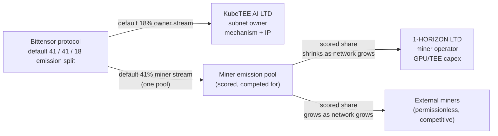
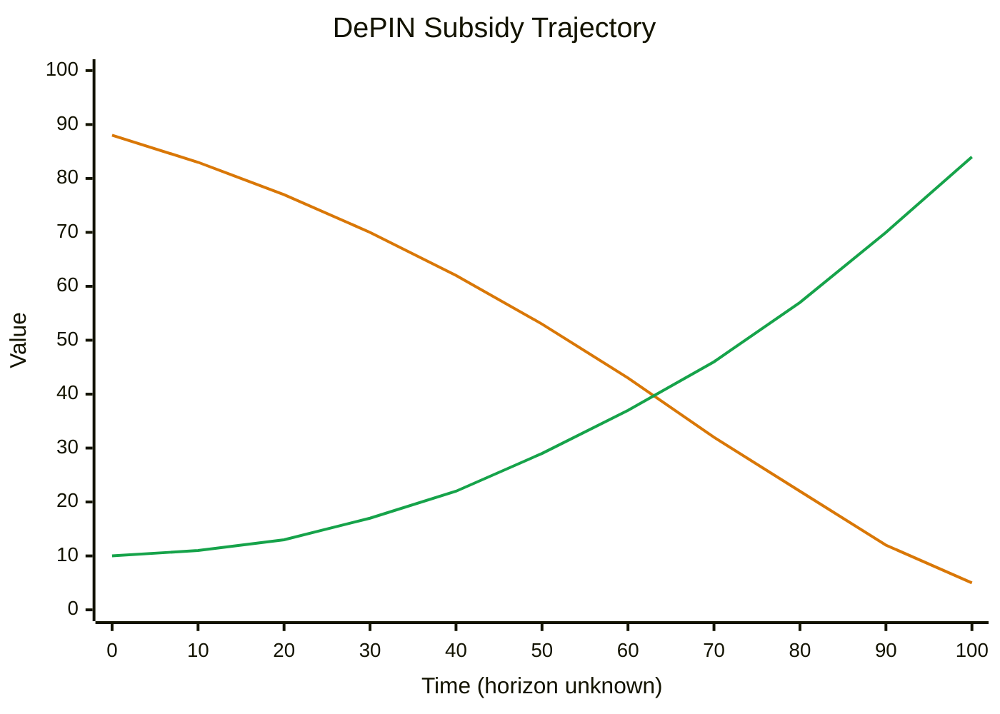

# Tokenomics — Utility Token & DePIN Model

This document is the full analysis behind the README [Tokenomics — Utility Token & DePIN Model](../README.md#tokenomics--utility-token--depin-model) section. It covers the economic design of SN90 (KubeTEE) Alpha: recycle vs burn, securities posture, TAO on Base, the cross-subnet consumption loop, the vertically-split corporate structure, and the DePIN subsidy trajectory.

> **Not legal advice.** The securities analysis below is engineering design rationale, not legal advice.

---

## Overview

SN90 (KubeTEE) Alpha is a **utility token consumed to access confidential compute**, not a security. The design follows a DePIN subsidy model:

- External inference demand buys Alpha on the **open market** and spends it to consume compute. TAO — the asset swapped for Alpha — is now also **live on Base** as a Chainlink CCIP-bridged ERC-20 (2026-08-21; see [TAO on Base](#tao-on-base)).
- Spent Alpha is **recycled** to unissued supply and can return through the protocol's emission process — a self-sustaining security budget for the compute network (the Bitcoin-fee model applied to Alpha). SN90's **default** emission split is 41% miners / 41% validators / 18% owner; this is configurable, not an immutable protocol guarantee.
- No entity sells tokens against promises, holds customer balances, or accumulates an operational treasury from unused miner emissions. All unused miner emissions are recycled; the owner-cut position remains owner-held under a non-decaying lock commitment. Value reaches each entity only through protocol safe-harbor channels (owner emissions, scored miner emissions).

The goal is a token whose value narrative is **compute access**, verifiable on-chain by anyone — the cleanest fact pattern for a utility-token / DePIN classification.

---

## Recycle vs Burn

### Mechanics

For a subnet's **Alpha**, burning removes tokens irreversibly but leaves both `SubnetAlphaOut` and `TotalAlphaIssuance` unchanged. Recycling also removes tokens from circulation, but it decreases `SubnetAlphaOut` and `TotalAlphaIssuance` by the recycled amount, restoring their capacity for future emission. This is the distinction between a token being gone and being returned to unissued supply.

The amount of Alpha a subnet emits per block is derived from its Alpha issuance through an issuance-driven halving curve. At each halving threshold the rate falls by half. Recycling Alpha therefore slows progress toward those thresholds and extends the emission runway; burning does not. This is an **Alpha** mechanism: burning or recycling a subnet's Alpha does not change the TAO issuance input used for the network-wide TAO emission curve.

### Three distinct burn/recycle paths

"Burn" and "recycle" are used for three different operations in this model. Combining their numbers would misstate the supply effects:

1. **Consumption spend.** When Alpha is spent for compute, the service-side payment flow calls the chain's `recycle_alpha` operation on the received Alpha. The tokens return to unissued supply; no entity retains them. This flow is planned together with paid jobs, not a statement that Early Access already bills customers.
2. **Unused miner emission.** The validator's USD-denominated scoring assigns the unearned remainder as weight on the owner UID. The protocol does not pay that remainder to the owner: under SN90's `recycle_or_burn=recycle` setting it is recycled (the alternative is burn). The withheld proportion is recorded in `MinerBurned` and reduces SN90's cross-subnet emission share before the emission gate, so this is a deliberate subsidy cost with no offsetting routing advantage.
3. **Per-block emission-weight slots.** A subnet has a `[burn, recycle, owner, validator, miner]` vector controlling that block's new Alpha emission. The burn and recycle slots are configured shares of **new emission**, not a limit on recycled customer spend or registration fees. Under SN90's intended default the vector is `[0%, 0%, 18%, 41%, 41%]`; the owner can change it subject to protocol bounds and rate limits. Root holders are paid out of the validator slot, so the amount ultimately available to Alpha validators need not equal the nominal 41%.

**Small burn, large recycle is supported by the mechanics — with an important qualification.** The per-block emission-weight vector caps the **combined burn and recycle shares at 33% of new emission**. It does not impose that cap on the separate `recycle_alpha` consumption-spend operation. That distinction supports the intended flow of a small emission-slot burn alongside unconstrained consumption recycling; it is not a claim that burning can never handle a large amount of Alpha. A single `burn_alpha` operation does not have that 33% cap. However, burning consumption leaves future miner compensation to the declining fresh-emission stream: at the issuance halving the original per-block rate is split in two, at the next into four, and so on. Refilling issuance is what makes the consumption-reflow model self-sustaining instead of waiting for fresh emission to approach zero. Nor should a large recycle be presented as boosting cross-subnet emission share: withheld miner emission is penalized through `MinerBurned` either way.

### Where "recycle instead of burn" does not buy anything

Choosing between recycle and burn of tokens is **not an emission-share optimization**: it changes supply, not the fact that the flow is recirculated. Emission weights, miner incentives, and the separate cross-subnet `MinerBurned` adjustment determine where and how much emission goes. Neither operation should be described as increasing SN90's emission share.

### Where it does matter

- **Alpha emission runway.** Recycling reduces the Alpha issuance input to SN90's emission curve and delays its issuance-driven halvings, preserving the ability to fund future miner emissions. Burning does not rewind that input. The corresponding trade-off is that recycled Alpha can be emitted again. This says nothing about TAO's emission schedule.
- **Price support.** Burning is irreversible and does not reduce `SubnetAlphaOut`. Recycling also reduces current liquid supply, but the recycled amount returns as future emission capacity — its sell-pressure relief is deferred rather than permanent. Burn is the stronger scarcity signal precisely because it is terminal.

The choice is a **sustainability versus terminal-scarcity trade**: recycle optimizes the network's long-run Alpha emission budget and future miner compensation; burn optimizes irrevocable holder scarcity.

### Why recycle for a compute subnet

For a compute subnet whose product is **ongoing work** (inference, training), recycle is the right economics: consumption funds future miner emissions — a self-sustaining security budget. The honest framing of the tradeoff: burn optimizes holder value and legal defensibility; recycle optimizes network sustainability and the operator's own future emission entitlement. A subnet can legitimately choose recycle and defend it as the more "commodity-like" behavior — reinvesting fees into the programmatic production of the commodity itself.

### Registration collateral can change where the registration fee goes (Phase 1)

Subtensor v437 adds a third possible destination for the registration price. With a nonzero `CollateralLockShare` (p), only the `(1 − p)` share is destroyed; the `p` share is **staked to the registering hotkey and locked**, then released back to withdrawable stake at `CollateralDrainRatio` (k) Alpha per Alpha of emission that hotkey earns.

**SN90's configured default is p = 0 in Phase 0** (verify the live registration parameters before describing deployed behavior). For the pinned Subtensor implementation, this is not an either-burn-**or**-recycle choice for the same Alpha: the TAO registration payment is swapped for Alpha, the burn-share Alpha is removed by directly decrementing `SubnetAlphaOut`, and the TAO registration charge is separately recorded through `RAORecycledForRegistration`. A nonzero `p` instead assigns the collateral share to the miner's registering hotkey. The **10 TAO per node deposit** miners will post directly onto their own hotkeys is **not collected in Early Access** — it is a validator-enforced requirement rather than a registration split, implemented in [Phase 1](../README.md#phase-1--expansion) (see [Miner deposit](../README.md#miner-deposit-registration-collateral)). Bonding a share of the registration price is also a [Phase 1](../README.md#phase-1--expansion) decision, because choosing `k` requires per-miner emission data the subnet does not have yet.

Three consequences worth stating plainly, because collateral is easy to mistake for a fee or a bond a platform holds:

- **It is not revenue and it is not a treasury.** The locked Alpha sits on the *miner's own* hotkey. KubeTEE never holds it, no KubeTEE key can move it, and it never appears on anyone's balance sheet. It does not touch the no-treasury posture above.
- **It is not slashable.** Bittensor has no confiscation extrinsic. A miner that breaches the SLA stops being scored, which stops its emission, which stops the lock draining — the deposit **freezes** on the miner's hotkey rather than transferring to anyone. Nobody is enriched by another miner's failure, so the mechanism creates no incentive to get rivals disqualified.
- **It would reduce the burned Alpha share of registration.** This is the one that matters for the model above, and the reason it is a deliberate Phase 1 decision rather than a default. With nonzero `p`, part of the purchased Alpha remains locked to the miner instead of being destroyed through the registration burn path; unburned Alpha from the swap remains outstanding and can be returned to the pool when unstaked. Set against that: a miner's route to recovering the collateral lock is constrained by the contract's drain rules as that hotkey earns emission, so collateral becomes a **claim contingent on doing the work** rather than an immediate disposable fee — closer to, not further from, the commodity framing above. The separate TAO burn/recycling record must not be relabeled as though the same Alpha were both burned and recycled.

---

## Securities Posture — No Treasury

SN90 has **no operational treasury funded by unused miner emissions**. Unearned miner emission is recycled to unissued supply by protocol rules rather than diverted into an entity-controlled treasury, and no customer-balance liability exists. The separate owner-cut Alpha is an explicit exception to the "nothing accumulates" shorthand: it accrues to the owner and is covered by the non-decaying lock policy below, not represented as recycled or ownerless. The substantive no-treasury claim is therefore no discretionary treasury accumulation or deployment of unused miner emission — not a claim that the owner can never hold any asset or that the system has zero discretion anywhere.

The SEC/CFTC interpretive release (Release No. 33-11412, March 17, 2026) applies the Howey test to **transactions** rather than assets themselves, and addresses how a non-security crypto asset may become subject to, and cease to be subject to, an investment contract. The question is not "is Alpha a security" but "do any of our practices create a scheme where purchasers reasonably expect profits from our managerial efforts." Eliminating the treasury eliminates the most attackable set of those practices up front.

### Fact patterns the no-treasury design avoids

1. **Receiving emissions (safe).** The release includes explicit safe harbors for protocol mining, staking, and airdrops — tokens received programmatically per protocol rules are not the problem. Under SN90's default split, the subnet owner's 18% and miners' 41% both arrive protocol-side; validators determine individual miner allocations by published scoring rather than paying miners from a KubeTEE treasury. Passive accrual to a wallet is hard to attack.
2. **Accumulating and holding a discretionary position (avoided).** A large discretionary insider position is a Howey factor (common enterprise, reliance on a promoter). A dormant treasury sits as ammunition for the argument that value depends on what you will do with it. With no treasury, there is no such position to characterize.
3. **Selling treasury to fund operations (avoided).** Emissions → sell → servers and salaries is functionally a continuous primary distribution funding the enterprise; if buyers reasonably expect the funded development to drive token value, those sales transactions start to look like investment contracts — even while secondary trading of the same token stays commodity-like. The token can be a digital commodity and treasury sales can still be securities transactions. With no treasury, there is nothing to sell this way.
4. **Deploying treasury for holder benefit (avoided entirely).** Buybacks, price support, liquidity backstops, yield programs, "treasury works for the community" messaging — anything that positions discretionary decisions as the value driver walks directly into the "expectation of profits from the essential managerial efforts of others" prong. With no treasury, there is no discretionary deployment to make.

### Why recycle fulfills the burn-adjacent posture

Durbin's programmatic purchase-and-burn model is extreme precisely because it removes the entire category: no accumulation, no discretion, nothing to mischaracterize. Burn makes consumption **terminal**: no beneficiary, no residual claim anywhere.

Recycling all unused emissions reaches the same posture by a different route: no treasury accumulates and no residual claim remains. Spent Alpha returns to unissued supply; when new Alpha is subsequently emitted, its allocation is governed by the chain's configured emission weights, validator weights, and Yuma Consensus rather than by a KubeTEE-held treasury or customer balance. The default 41/41/18 split is not immutable, and validators do exercise bounded scoring discretion. The load-bearing property is **no discretionary custody, resale, buyback, or deployment of accumulated tokens**, not the choice of burn over recycle and not a fiction of zero discretion anywhere in the system. For a compute subnet whose product is ongoing work, recycle preserves the emission runway that funds future miner compensation while keeping the same "nothing to mischaracterize" posture.

### Mitigants

- Token is already functional (used per its programmatic utility on a functional system).
- No fundraising framing, no roadmap promises tied to sales.
- Arm's-length OTC disposal of any emission the owner entity does liquidate.
- Disclosure — especially important for a related-party structure.
- No staking of accumulated balances for yield (would add a passive-income feature on top).

### Owner position with non-decaying lock

The subnet owner — **KubeTEE AI LTD** (owns the mechanism, the $198k (≈1,003 TAO) subnet registration, and the **default** 18% owner emission stream; no token sales against promises, no customer balances, no treasury — all unused emissions are recycled; see [Corporate Structure](#corporate-structure-vertically-split)) — commits to enabling the chain's **perpetual lock** on its SN90 position and to auto-locking its owner-cut Alpha.

This is a real on-chain mechanism, not merely an off-chain re-locking script:

- The owner coldkey can enable `set_perpetual_lock(netuid, true)`. While enabled, its individual locked Alpha mass does not decay; ordinary locks decay by default.
- With `OwnerCutAutoLockEnabled` enabled, the coinbase owner-cut distribution automatically calls the lock operation for the retained owner-cut Alpha. This prevents that Alpha from arriving as an immediately withdrawable liquid payout.
- The lock is a **non-decaying commitment device, not a burn**. The same owner coldkey can call `set_perpetual_lock(netuid, false)` to restore decay, and the owner/root can change the auto-lock configuration subject to protocol controls. The commitment is that KubeTEE does not do so and does not otherwise withdraw the position. A liquid position under an unwithdrawable key would be different; this chain setting does not establish that.

It complements the no-treasury posture on the owner side but is not a substitute for it. Owner-cut Alpha still accrues to the owner coldkey before it is locked: the mechanism makes it non-decaying and illiquid rather than recycling it or placing it in a third-party trust. KubeTEE's commitment therefore limits owner exit and discretionary liquidation; it does not mean the owner has no position, no economic upside, or no ability to change configuration.

A perpetual Alpha lock also reduces circulating float and uses none of the 33% combined burn/recycle emission-weight allowance. Those are genuine advantages over allocating a large burn share. A locked balance nevertheless remains an owned asset and a treasury-like policy commitment; it cannot be presented as burn-equivalent, as an irreversible no-disposal guarantee, or as removing the concentration and incentives considered in this analysis.

---

## TAO on Base

**TAO is live on Base** as of 2026-08-21 — announced by [ForeverMoney (SN98)](https://x.com/forevermoney_ai/status/2090469070248235027). It is a Chainlink **CCIP-bridged ERC-20** of native Finney TAO, not a new token and not liquid-staked xTAO (Project Rubicon). Same asset, two rails.

| | Finney TAO | TAO-on-BASE |
|---|---|---|
| Chain | Bittensor (Subtensor) | Base (Coinbase L2) |
| Form | native `TAO` | ERC-20 `TAO` |
| Contract | — (native) | [`0xf3081494b87e8d5fb7960f066e931d1d0e6e3d67`](https://basescan.org/token/0xf3081494b87e8d5fb7960f066e931d1d0e6e3d67) |
| Bridge | — | Chainlink CCIP via [forevermoney.ai](https://forevermoney.ai/) |
| Spot market | SN dTAO pools (TAO ↔ Alpha) | Aerodrome TAO/USDC |

What this changes for SN90:

- **Acquisition is no longer Bittensor-wallet-only.** A consumer (or a consuming subnet's treasury) can buy TAO from USDC or ETH in any Base wallet, then CCIP-bridge to Finney and swap into SN90 Alpha on the open pool. The "must download a Bittensor wallet first" friction that kept EVM capital off-subnet is gone.
- **Phase 1 billing gets a native Base settlement asset.** The Early Access path is Alpha / Finney TAO; demand-side paid jobs at a resources price per hour are a [Phase 1 roadmap item](../README.md#phase-1--expansion). Phase 1 layers **Alpha / TAO paid jobs** and **USDC-on-BASE and TAO-on-BASE** pull-based billing on top. The USDC→TAO hop is now a Base DEX swap (Aerodrome), not a custom KubeTEE bridge. Recycle still happens on Finney: USDC-on-BASE (or TAO-on-BASE) → CCIP → Finney TAO → SN90 Alpha → spend → recycle.
- **The no-treasury / no-discount posture does not change.** TAO-on-BASE is another on-ramp onto the same open-pool acquisition leg. There is still no preferential Alpha placement, no volume discount, and no KubeTEE-held customer balance. A Base wallet buying TAO on Aerodrome and a Finney wallet swapping TAO for Alpha are the same economic act.

What this does **not** change: SN90 Alpha is still the access ticket; the design still recycles spent Alpha on Finney; SN90's default emission split remains 41% miners / 41% validators / 18% owner (with root holders paid out of the validator slot). Bridged TAO is a representation of Finney TAO, so circulating supply on Base is locked on Finney — it does not mint extra TAO.

---

## Cross-Subnet Consumption Loop

### The protocol-native (no-invoice) model

The cleanest structure is the **protocol-native model**: SN90's Alpha is the access ticket to the compute; any other subnet or AI service (e.g. an inference subnet like SN64 / Chutes) acquires it on the open market and spends it to consume. No bilateral paper anywhere.

**Securities-wise this is the strongest possible fact pattern for SN90.** The absence of a contract is not a gap — it is the feature. There is no bilateral scheme to characterize as an investment contract, just spot acquisition of a token followed by its consumptive use, which lands squarely in the release's carve-out that securities laws generally do not apply to items purchased for use or consumption.

Better still, it upgrades SN90's own token classification: an Alpha that **must be spent to obtain compute** is a token with genuine programmatic utility on a functional system — precisely the digital-commodity definition — rather than a token whose only story is speculation. Demand from subnets and AI services gives organic, verifiable consumption.

### The flywheel

```mermaid
flowchart LR
    Cust["External customers<br/>pay fiat for AI services"] --> Cons["Subnets & AI services<br/>(e.g. SN64 / Chutes inference)"]
    Base["BASE L2<br/>USDC / ETH"] -->|"Aerodrome swap"| BaseTAO["TAO-on-BASE<br/>CCIP ERC-20"]
    BaseTAO -->|CCIP bridge| Cons
    Cons -->|swap TAO for Alpha<br/>on open pool| Pool["SN90 Alpha pool<br/>(open market, no discounts)"]
    Pool -->|Alpha| Cons
    Cons -->|spend Alpha<br/>for compute| SN90["SN90 (KubeTEE)<br/>confidential compute"]
    SN90 -->|spent Alpha recycled| Unissued["Unissued supply<br/>(zero discretion)"]
    Unissued -->|re-emit via the configured split<br/>(41 / 41 / 18 by default)| Proto["Bittensor protocol"]
    Proto -->|miners / validators / owner| SN90
    Cons -.->|run validator on SN90| Val["Consumer-aligned validator<br/>scores miner output = SLA"]
    Val -.->|Yuma Consensus| Proto
```

The acquisition leg is where the value transfer happens: a consuming subnet or AI service swaps TAO into SN90's pool to get Alpha — that swap is the real payment. Every purchase is TAO inflow into SN90's reserve and upward pressure on the Alpha price. TAO itself can now be bought on **Base** (USDC/ETH → Aerodrome → TAO-on-BASE → CCIP → Finney) as well as on Finney, so the buyer set is any EVM wallet, not only a Bittensor-native one. Under the current emission model, each subnet's base emission share follows its EMA token price normalized across all subnets; that share is then adjusted for `MinerBurned` and the emission gate. Sustained consumer buying can therefore raise SN90's base emission share, other things equal, but does not guarantee a one-for-one increase in realized emission. The flywheel: external enterprise AI-service revenue → consumers buy SN90 Alpha → price and emissions rise → miner incentive grows → more compute capacity → more services served. Because consumer demand is funded by outside customers, this is genuinely **external demand one hop removed** — not the circular emissions-recycling pattern that gets subnets dismissed as hot-potato economics.

### The spend leg (design decision)

When a consumer spends Alpha for compute, SN90's mechanism decides what happens to it:

- **Burn** — permanent supply reduction, does not touch `SubnetAlphaOut`, maximum scarcity signal.
- **Recycle** (chosen) — returns Alpha to unissued supply, reduces `SubnetAlphaOut` and Alpha issuance, slows SN90's issuance-driven emission decay, and restores capacity for future Alpha miner emissions. It does not pay the consumed token directly to miners.
- **Route to miners** as supplemental incentive on top of emissions — directly couples miner pay to real usage (tightest incentive alignment) but reintroduces sell pressure since miners liquidate.

Recycle is the mechanically interesting choice for a compute subnet: recycling consumption back into future miner emissions is a self-sustaining security budget, the Bitcoin-fee model applied to Alpha.

### Reflexivity risks (the flywheel spins both ways)

- **Concentration**: if any single subnet or AI service becomes the dominant source of TAO inflow, SN90's emission share is a derivative of one customer's purchasing schedule. The day they pause, your price EMA decays, emission share follows, miner revenue drops, and capacity exits. Single-customer alpha demand is how a subnet deregisters fast — diversify the consumer base across multiple subnets and services.
- **Predictability**: if a consumer buys on a fixed cadence sized to revenue, that flow is visible on-chain and will be front-run. Use continuous small swaps (TWAP-style) rather than monthly lumps — this also smooths the EMA rather than spiking it.
- **Inventory exposure**: a consumer holds SN90 Alpha between purchase and spend, carrying the token's volatility as working-capital risk. The deeper the pool, the smaller that risk; pool depth is partly the subnet owner's problem to solve.

### Quality enforcement without contracts

No SLA means SN90's validators **are** the SLA: scoring must measure exactly what consumers experience — latency, throughput, uptime, correctness of the compute delivered — or miners will optimize for the metric while consumers experience something worse. An elegant protocol-native option: a consuming subnet or AI service (or an entity aligned with them) runs a validator on SN90, so the customer's own quality observations feed Yuma Consensus directly. The customer scores the vendor's workers, and the chain settles it.

### Keep the loop at the market layer

The clean version is entirely arm's-length at the market layer: every consumer swaps on the open pool like anyone else, spends like anyone else, and SN90's edge is just being the subnet whose token has real consumers (subnets and AI services, not just one named partner). That is also the version where the flywheel narrative — usage-backed Alpha demand — is verifiable by anyone reading the chain.

---

## Corporate Structure (vertically split)



- **KubeTEE AI LTD — subnet owner**: owns the subnet layer (mechanism, the $198k (≈1,003 TAO) registration, the default 18% owner stream — owner position covered by the auto-lock and perpetual-lock commitment). Receives value only through the owner-emission safe-harbor path.
- **1-HORIZON LTD — miner operator**: a miner competing inside SN90 for a slice of the default 41% miner pool. Funds GPU, TEE hardware, and rack commitments. Registers, competes, and is deregistered under identical rules as every other miner — same registration cost, same immunity period, no reserved UIDs.

### What the split gets right

Separating the subnet-owner entity from the miner entity means each receives value **exclusively through protocol safe-harbor channels**: KubeTEE's default 18% arrives as owner emissions; 1-HORIZON's share arrives as scored miner emissions. Neither entity needs to sell tokens against promises, hold customer balances, or accumulate a treasury — all unused emissions are recycled. Capex lands in the right place — GPUs, TEE hardware, rack commitments sit in 1-HORIZON, insulated from the subnet-layer entity, which owns only the mechanism and IP.

### Concentration risk (classification risk is concentration, not existence)

A related-party miner on the subnet is unremarkable — most owner teams bootstrap capacity this way. What degrades both the DePIN story and the digital-commodity posture is **1-HORIZON becoming the dominant miner**: at that point the network is not meaningfully permissionless, the compute consumers pay for is mostly produced by the owner's sister company, and token value starts depending on one director's operational decisions across both entities — the managerial-efforts prong creeping back in. This is the "own a DC, fully self-mine, limit access" anti-pattern.

### Load-bearing mitigations (in order)

1. The incentive mechanism must be **objective and published**, scoring measurable compute properties so no validator judgment call can favor 1-HORIZON.
2. The validator set should include parties KubeTEE does not control (a consumer-aligned validator from a consuming subnet or AI service doubles as both quality signal and independence proof).
3. 1-HORIZON registers, competes, and is deregistered under identical rules as every other miner — same registration cost, same immunity period, no reserved UIDs.
4. **Want external miners to out-compete 1-HORIZON over time** — a declining related-party share is the on-chain evidence the network is real. Target state: a taostats chart where the related-party (purple) share shrinks as external (gray) miners grow.

---

## DePIN Subsidy Trajectory



The amber **emission subsidy** line decays as emissions taper over an unknown horizon; the green **consumption revenue** line rises as consumer spend (from subnets and AI services) grows. They cross at the **crossover** — the point where consumption recycling offsets miner emission at the current rate, rather than depending on continually rising net Alpha issuance. The exact date is unknown because recycling changes SN90's issuance balance and therefore the timing of its issuance-driven halvings; the x-axis is an undated horizon, not a halving schedule.

### The DePIN subsidy thesis

Consumers (subnets and AI services) get compute at below-market price because SN90 emissions subsidize the cost of compute. This is the goal of SN90: help subsidize the cost of compute, with a more efficient tech stack that monetizes compute better than a VM.

### Mechanics of who is paying

A miner's all-in compensation is **emissions plus consumption spend**. When emissions cover most of the cost base, miners can price delivered compute below their cash cost, and the consumer pockets the gap. That gap is not free — it is paid by **Alpha dilution**, i.e., by stakers and holders absorbing issuance. The honest description: token holders are collectively funding customer acquisition for the compute network. That is legitimate DePIN bootstrapping (the Helium/Filecoin/io.net playbook), and stated that way it is also classification-safe — the discount is protocol-programmatic, available to anyone who buys Alpha on the open pool, not a managerial pricing decision.

### Net issuance and the crossover

The decomposition below concerns only the SN90 miner-incentive flow that the consumption/refill model is intended to offset:

`net miner Alpha issuance = fresh miner Alpha paid out − Alpha recycled from consumption`.

It must **not** be equated with Total Alpha Supply on an explorer. A full-subnet `get_alpha_issuance(netuid)` read is `SubnetAlphaIn + SubnetAlphaOut + protocol Alpha reservoir`; the pool-side Alpha can change independently of miner compensation, and separate owner/validator/root and any configured burn/recycle-slot flows also exist. Protocol source commentaries sometimes use `subnet issuance` and `TotalAlphaIssuance` for narrower accounting counters; the metric and denominator must be named explicitly when publishing a number.

- **Pre-crossover (amber)**: low utilization; inflation-funding the subsidy.
- **Crossover**: as consumer spend grows, recycling offsets more fresh miner payout; when consumption recycling equals that payout, net **miner-flow** issuance is roughly zero, and the "subsidy" has become a closed loop in which consumption replenishes future miner emissions.
- **Past crossover**: the refill ratio is above one at the then-current emission schedule, but it cannot rise without a corresponding net-supply correction — as recycling lowers issuance, the halving curve decays, eventually falling below recurring spend and restoring balance. Emission-rate decay after the crossover is natural; indefinite negative issuance is not a coherent endpoint.

A miner-flow issuance measure near zero also does not mean that emission has stopped: recycled Alpha can be re-emitted at the current block rate. The crossover is therefore about offsetting new issuance with consumption, not about conservation of tokens through a literal same-token miner-payment pipeline.

This gives a single on-chain KPI worth publishing from day one — the **subsidy ratio** (fresh miner-emission value ÷ total miner compensation) — and its required trajectory is **monotonically down**. The numerator must exclude any recycled-consumption component to avoid double counting; total Alpha changes are not a substitute for this ratio. That number declining is simultaneously the economic health metric, the DePIN credibility proof, and the answer to anyone claiming the token only exists to farm emissions.

### Defenses against the reflexive spiral

Failure mode: Alpha price falls → subsidy value shrinks → below-market pricing evaporates → consumers route compute elsewhere → consumption falls → price falls further.

1. **Subsidy tapers by policy expectation, not by surprise.** If a consumer builds unit economics assuming permanent 40%-below-market compute, the first halving breaks their margin model and the demand simultaneously. Consumers should price in a published glide path.
2. **Stack efficiency is the moat.** If the KubeTEE stack genuinely extracts more revenue per GPU-hour than VM rental — Kubernetes bin-packing multiple workloads per card instead of dedicated-VM idle time, TEE attestation commanding a confidential-compute premium, higher effective utilization — then part of the discount is structural and survives emission decay. Emissions buy time; stack efficiency is the moat. A subnet whose price advantage is 70% subsidy / 30% efficiency at launch needs to be 30/70 by crossover.

### Wash consumption (attack surface specific to subsidized-compute subnets)

If the incentive mechanism scores miners on utilization, a miner can spend Alpha consuming its own compute — the spend recycles, but the score farms emissions worth more than the spend. Defenses:

- Score **verifiable properties** instead: delivered capacity, attested TEE execution, latency/correctness on validator-issued challenges.
- Treat real consumption as a demand signal rather than the direct emission driver, **or** make self-consumption economically neutral (spend ≥ emission value gained).

Given 1-HORIZON mines on the subnet its sister company owns, this must be closed before anyone asks — a related-party miner on a utilization-scored subnet is exactly where an observer would go looking first.

SN90 takes the first defense: miners are scored on provable available capacity, so self-consumption buys a related-party miner no score and the spend is pure loss. The residual is on the demand side — the planned competitive-pricing formula derives `demand_pressure` from Armada queue depth, and a deeper queue lifts the target price every miner is scored against. That must be closed before the term bears weight: see [Wash consumption (open question)](./COMPETITIVE-PRICING.md#wash-consumption-open-question).

---

## Boundary Conditions (what breaks the model)

1. **Unbounded owner-hotkey withholding** of miner emission — the documented automatic recycle of the unearned remainder is supported by the chain, but any withdrawal, diversion, or undisclosed deviation is disqualifying. Heavy owner-associated miner emissions also cost realized emission through `MinerBurned`; a published recycle policy does not remove that economic penalty or the concentration concern.
2. **Discretionary accumulation** inserted between spend and recycle (no treasury — any accumulation is the poison; all unused emissions must be recycled).
3. **Public messaging** that frames Alpha appreciation — rather than compute access — as the reason to hold.
4. **Preferential Alpha placement**, side-letters, or volume discounts to large consumers — contaminates the loop into a primary distribution with investment characteristics.
5. **Owner disabling perpetual lock or unlocking its position** — non-decay and auto-lock are the commitments; disabling the lock would gradually restore withdrawability rather than instantly convert the entire position into liquidity. Liquidation would re-introduce the discretionary liquid insider position and the incentives this design seeks to constrain.

The mechanism is defensible only as long as the story told about it matches the arrows.

---

## Source verification note

The mechanics in this document were checked against the `subtensor/` source snapshot pinned by this repository on 2026-11-05. In particular:

- `pallets/alpha-assets/src/lib.rs`: `mint_alpha` increases `TotalAlphaIssuance`; `burn_alpha` records `AlphaBurned` without decreasing issuance; `recycle_alpha` decreases `TotalAlphaIssuance`.
- `pallets/subtensor/src/coinbase/alpha.rs`: recycling decrements `SubnetAlphaOut`; burning does not.
- `pallets/subtensor/src/staking/stake_utils.rs`: current full-subnet Alpha issuance is `SubnetAlphaIn + SubnetAlphaOut + protocol Alpha reservoir`.
- `pallets/subtensor/src/coinbase/block_emission.rs` and `coinbase/run_coinbase.rs`: both TAO and per-subnet Alpha emission are issuance-driven; Alpha emission follows its subnet issuance.
- `pallets/subtensor/src/subnets/emission_weights.rs`: the five-slot `[burn, recycle, owner, validator, miner]` emission-weight vector, its default 0/0/18/41/41 allocation, and validation limits including combined burn+recycle ≤33%. The default is not a permanently fixed split.
- `pallets/subtensor/src/coinbase/run_coinbase.rs`: configured-slot processing; owner-associated miner incentives are recycled/burned under `RecycleOrBurn`, not credited to owner keys.
- `pallets/subtensor/src/coinbase/subnet_emissions.rs`: EMA-price shares are scaled by `1 − MinerBurned` and then processed by the emission gate.
- `pallets/subtensor/src/staking/lock.rs` and `macros/dispatches.rs`: `set_perpetual_lock(true)` suppresses locked-mass decay, can be disabled by the coldkey, and owner-cut auto-lock depends on `OwnerCutAutoLockEnabled`.

These are code-level facts about the pinned source, not a claim that every SN90 configuration flag has been individually verified on live Finney in this document-review pass. Check live chain configuration before treating a default or intended setting as deployed state.

## References

- [Bittensor dTAO Whitepaper](https://bittensor.com/dtao-whitepaper)
- [Emission in Dynamic TAO](https://docs.bittensor.com/dynamic-tao/emission)
- [Recycling — Learn Bittensor](https://learnbittensor.org/concepts/tokenomics/recycling)
- [Recycling — TaoStats](https://docs.taostats.io/docs/recycling)
- [Tao Emission — TaoStats](https://docs.taostats.io/docs/tao-emission)
- [TAO live on Base](https://x.com/forevermoney_ai/status/2090469070248235027) — ForeverMoney (SN98), 2026-08-21
- [ForeverMoney bridge](https://forevermoney.ai/) — Finney TAO ↔ TAO-on-BASE via Chainlink CCIP
- [TAO-on-BASE (Basescan)](https://basescan.org/token/0xf3081494b87e8d5fb7960f066e931d1d0e6e3d67) — ERC-20 `0xf3081494b87e8d5fb7960f066e931d1d0e6e3d67`
- [Bittensor (CCIP-Bridged) — CoinGecko](https://www.coingecko.com/en/coins/bittensor-ccip-bridged)

